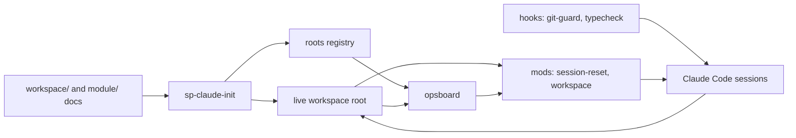

# project-template plan

Updated 2026-10-12. This plan owns this repository's goals, components, tracks, the order
of work and releases. It is the plan of project-template itself: setup copies only
`workspace/` and `module/` into a new workspace, never this file. History: git log and
the [decisions](#decisions) below.

## Contents

1. [What project-template is](#what-project-template-is)
2. [How it fits together](#how-it-fits-together)
3. [Components and ownership](#components-and-ownership)
4. [Design for public and personal use](#design-for-public-and-personal-use)
5. [Tracks and order](#tracks-and-order)
6. [Tracker: open steps](#tracker-open-steps)
7. [Releases and versions](#releases-and-versions)
8. [Rules for this repository](#rules-for-this-repository)
9. [Public release](#public-release)
10. [Decisions](#decisions)

## What project-template is

A template and its tooling for running a coordinated super project: a root repository with
module submodules, several Claude Code sessions in parallel, each the only writer of its
repositories, git only after the operator's approve, and one checkpoint per milestone.
The docs and the tooling that reads them (mods, hooks, ops board, bootstrap, skill
templates) live here; `tooling/install` links the tooling into `~/.claude` and `BIN_DIR`.
[T4](#t4-autopilot-m2) adds a second mode, autopilot: the operator decides ahead, and
Claude builds, reviews, merges and releases unattended.

**Defaults:**
- Build only what a live workspace needs.
- One operator, Linux, Claude Code. Packaging, a plugin marketplace, macOS and other
  agents are deferred.
- Personal values (paths, registered roots, private strings, signing) live in local
  config, never in the repository.
- Developed in the open from 2026-10-12 on ([D11](#decisions)).

## How it fits together

- **Docs** (`workspace/`, `module/`): the files and headings the tooling parses, the docs
  contract in [WORKFLOW.md](WORKFLOW.md) section 3.
- **Bootstrap** (`sp-claude-init`): checks the contract, copies the project skills and
  registers the root.
- **Ops board** (`opsboard`): the one parser of `operator.md` and `handoffs.md`; the
  workspace mod reads its `--tsv` output.
- **Mods**: session-reset gates git on the operator's approve and restarts the session
  after a commit; workspace guards writes by session and shows the band and the `/ops`
  pane.
- **Hooks**: git-guard blocks destructive git; typecheck sends Claude back on a failing
  type check.

## Components and ownership

One track writes each component at a time. Every component lives under `tooling/`, and
`tooling/install` links it to the path it runs from.

| Code | Component | Owns | Track |
|---|---|---|---|
| DOC | Template docs | README, WORKFLOW, SETUP, `workspace/`, `module/` | T1, then T4 |
| MOD | Mods | session-reset, workspace | T1, then T4, then T2, then T3 |
| BIN | Scripts | opsboard, sp-claude-init, session-sweep, commit-all, push-all, leak-check, publish-check, gh-harden, sp-autopilot | T1, then T4, then T3 |
| HOOK | Hooks | git-guard, typecheck, the pre-push hook | T1 |
| SKL | Skills and commands | skill templates, `/session`, `/operator-steps` | T1, then T4, then T2 |
| PUB | Publishing | `tooling/publish/` (hardening reference, templates, rulesets) | T1 |

## Design for public and personal use

Going public from the start keeps the operator's setup working as it does today. It
takes five small pieces, not a framework:

1. **The repository is the live source.** `tooling/install` symlinks the files into
   `~/.claude` and `~/bin`, so an edit here is the tool that runs. There are no copies to
   drift. Project skills are still copied per root by `sp-claude-init`.
   - **Updating a root.** `sp-claude-init` can run again on a root: it records what it
     placed in `.claude/project-template.lock`, updates each file nobody edited, and keeps
     (and reports) the edited ones. `sp-update [--ref <tag>] [--global] [root …]` unpacks a
     version (default: the newest `main`) under `~/.local/share/super-project/versions/`,
     runs that version's `sp-claude-init` on each root, and lists the template doc changes
     since the root's last version, to merge by hand. `--global` also runs that version's
     install, pinning the global tools to it; `tooling/install` from a checkout links them
     back to the checkout.
2. **One local config file** holds the personal values: the projects folder, the roots
   registry and the private-strings path. The repository ships an example with neutral
   defaults.
3. **Extension points instead of forks.**
   - A per-root `.claude/workspace.json` holds workspace-specific rules, such as a runtime
     script only one session may run (today hardcoded in the workspace mod).
   - A private overlay folder holds skills and mods that stay private, such as the finance
     skill or a rule that needs code.
   - The personal `~/.claude/CLAUDE.md` imports the shipped git rules with `@` and adds
     its own lines, such as how commits are signed.
4. **A leak guard.** `tooling/bin/leak-check` runs gitleaks and the local private-strings
   denylist, printing counts and file names only. A pre-push hook runs it; CI runs
   gitleaks.
5. **Tests and CI.** shellcheck, the mod tests that exist today, and gitleaks, with
   actions pinned by SHA.

### Layout and config (D1)

**Layout.** `tooling/install` links each file to the path it has today, so nothing that
calls it changes. Skills are not linked: `sp-claude-init` copies them from the repository,
found through its own symlink.

| Repository path | What | Installed at |
|---|---|---|
| `workspace/`, `module/` | Template docs, copied by setup | — |
| `tooling/bin/` | `opsboard`, `sp-claude-init`, `sp-update`, `commit-all`, `push-all`, `sp-config`, `leak-check`, `publish-check`, `gh-harden` | `BIN_DIR` |
| `tooling/bin/session-sweep.sh` | Session sweep | `~/.claude/bin/` |
| `tooling/hooks/` | `git-guard.sh`, `typecheck.sh` | `~/.claude/hooks/` |
| `tooling/mods/` | `session-reset/`, `workspace/` (whole folders) | `~/.claude/mods/` |
| `tooling/commands/` | `session.md`, `operator-steps.md` | `~/.claude/commands/` |
| `tooling/skills/` | `add-objective`, `balance-sessions`, `go-public`, `milestone-checkpoints`, `publish`, `zed-settings.json` | copied per root by `sp-claude-init` |
| `tooling/claude/git-rules.md` | The git rules, without personal lines | `~/.claude/git-rules.md`, imported by `~/.claude/CLAUDE.md` |
| `tooling/git-hooks/pre-push` | Runs leak-check on what a push sends | this checkout's `.git/hooks/` |
| `tooling/publish/` | The GitHub hardening reference, its rulesets (PUB-1.13) and templates (PUB-1.14) | — |
| `tooling/config.example` | Every config key with its default | — |
| `tooling/install` | Links, backs up, `--check` | — |

The generated plugin types (`.claude-plugin/types/`) and `node_modules` are never
committed.

**Config.** One file, `${XDG_CONFIG_HOME:-~/.config}/super-project/config`, holds
`KEY=value` lines. `#` starts a comment, and a leading `~` expands; nothing else expands.
Scripts read it through `sp-config KEY`, which prints the value or the default; the mods
use the same parsing rules. A missing file means every default applies.

| Key | Default | Read by |
|---|---|---|
| `PROJECTS_DIR` | `~/projects` | session-sweep, `/operator-steps`, SETUP: where a bare workspace name resolves and new roots go |
| `PUBLISHED_DIR` | `PROJECTS_DIR/published-oss` | the publish and go-public skills of the export model; dropped in PUB-1.16 ([D11](#decisions)) |
| `ROOTS` | `~/.config/super-project/roots` | opsboard, the mods, sp-claude-init, session-sweep, `/operator-steps` |
| `PRIVATE_STRINGS` | `~/.config/super-project/private-strings.txt` | leak-check, the publish skill |
| `BIN_DIR` | `~/.local/bin` | install; the workspace mod finds `opsboard` there |
| `OVERLAY_DIR` | `~/.config/super-project/overlay` | `sp-claude-init --skill <name>` copies from `skills/`; install adds each folder in `mods/` to the plugin dirs it prints |

The operator's config keeps today's locations (`ROOTS`, `PRIVATE_STRINGS`, `BIN_DIR`), so
no file moves.

**Workspace rules.**
- **Data rules** go in `<root>/.claude/workspace.json`:
  `{"runtime": {"scripts": [...], "runners": "<session ID regex>", "free": [...],
  "dockerFree": [...], "cite": "<plan section>", "commitFirst": {"<subcommand>":
  [<repositories>]}}}`. This is the former hardcoded runtime table, unchanged in meaning,
  plus the repositories that must be committed before a subcommand runs.
- **Rules that need code** become a private mod in the overlay. An example is a check of
  a build script's internals, which today lives inside the workspace mod.
- `--finance` becomes `--skill exact-values`, copied from the overlay.

**Stays private, never in the repository:**
- the config file, the roots registry and the private-strings list;
- the overlay (the finance skill, workspace-specific mods);
- `~/.claude/settings.json`, and the personal lines of `~/.claude/CLAUDE.md` (how
  commits are signed);
- tools outside this workflow: the status line, the GitHub MCP wrapper, other hooks.

**Dropped:** `attn.sh`. Its board no longer runs, and T3 replaces it.

### Publishing in the open (D11)

**The model.**
- A repository goes public under its own name and is developed in the open from then on.
  There is no export and no second copy: pull requests merge into `development`, and
  releases tag the same repository.
- Its history decides how. If `leak-check --history` finds nothing, the repository itself
  turns public. If not, one audited snapshot of its tree becomes the first commit of a new
  repository with the same name. The old one is renamed `<repo>-private` and archived,
  and the local checkout is replaced by a clone of the new one. History is never
  rewritten.
- What stays private lives outside the repository: the local config, the private-strings
  list, the overlay. A workspace root may stay private while its modules are public.
- After the first release the repository is ordinary: its sessions develop it in the
  open, its checkpoints tag it, and no publish session runs for it again. Every push is
  public at once, so the pre-push hook and CI are the gates from then on.

**The local gates** (`publish-check`; `--snapshot` skips the history, which a snapshot
does not carry):
1. The working tree is clean and committed.
2. `leak-check` on the tracked files, and `leak-check --history` unless `--snapshot`.
3. The public files exist and are not empty: LICENSE, README.md, SECURITY.md,
   CONTRIBUTING.md, CHANGELOG.md, `.gitignore`.
4. CI: at least one workflow in `.github/workflows/`; each has a top-level
   `permissions:`; every `uses:` is pinned to a full commit SHA (local `./` actions and
   `docker://` images aside); a step runs gitleaks or `leak-check`. zizmor, when it is
   installed, finds nothing; when it is not, a `warn`.
5. `.github/dependabot.yml` covers `github-actions`.
6. The pre-push hook is installed: a link to `tooling/git-hooks/pre-push`, or
   `core.hooksPath` holds it.
7. Commits are signed: `commit.gpgsign` is true and `user.signingkey` is set.
8. A repository with an AGENTS.md has its "Public repository" section.

**GitHub**, in this order ([tooling/publish/hardening.md](tooling/publish/hardening.md),
applied by `gh-harden`):
1. Once per account, by the operator: the signing key on GitHub as a signing key,
   vigilant mode, two-factor.
2. Before the switch: features and merge settings; Actions (selected actions, SHA
   pinning, a read-only token, approval for outside contributors); private vulnerability
   reporting; Dependabot alerts and security updates; immutable releases.
3. The operator switches visibility. Never a script, never a session.
4. After the switch: secret scanning and push protection, and CodeQL default setup (both
   free once public). Then the rulesets, once CI has passed on each protected branch:
   `main` (no deletion, no force push, signed commits, the CI check), `development` (no
   deletion, no force push, signed commits), tags `v*` (no update, no deletion).
5. `gh-harden` with no option reports every item `ok`.

**The action.** The operator says which repository should go public; the rest is planned
for them.
- `/go-public <repo>` (skill `go-public`) runs in a plain session at the workspace root,
  or in a standalone repository for itself. It reads the repository and writes only
  plans:
  1. It runs `publish-check` and `publish-check --snapshot` and reads
     `gh repo view --json visibility,defaultBranchRef`. From that it picks in place or
     snapshot and lists the failing gates, with counts and file names only.
  2. It writes the steps `<CODE>-P1`–`P6` into the module plan (or the standalone
     repository's plan.md "Public release" section). Each step's "Done when" is the gate
     it clears. In a workspace it also adds the release table row, a decision and the
     `planned` status row.
  3. It writes the operator tasks with their exact commands or settings pages: the
     account items, for a snapshot the rename, archive and new empty repository, the
     visibility switch and the UI-only items.
  4. It shows the Ready to commit preview.
- `/session publish-<repo>` (skill `publish`) works the steps:
  - **P1 Security audit:** threat model, dependency advisories, `leak-check` (counts only).
  - **P2 Cleanup:** dead code, private paths and defaults, docs for strangers.
  - **P3 Public files** from `tooling/publish/`, and the AGENTS.md "Public repository"
    section.
  - **P4 CI and Dependabot** from the templates; the pre-push hook through
    `tooling/install --hook <repo>`.
  - **P5 Gates:** `publish-check` passes; the operator reads every tracked file and signs
    off.
  - **P6 Go public**, each git and `gh-harden --apply` command from a preview. In place,
    or the snapshot: `git checkout --orphan public # approved`, one commit, pushed to
    `development` and `main` of the new repository. CI passes; `gh-harden --apply`; the
    operator switches visibility; `gh-harden --apply` again and then `gh-harden` all
    `ok`; the first tag and Release. The status row becomes `published <date>`.
- **A snapshot in a workspace** replaces a submodule's checkout, which is an operator
  task: after the push, `git -C <root> submodule deinit -f <repo>`, remove
  `.git/modules/<repo>`, clone the new repository in its place and run
  `git -C <root> submodule absorbgitdirs <repo>`. The next checkpoint records the new pin.

## Tracks and order

One session at a time works here, from a plain session in this repository; it is not a
registered root. The tracks run in the order of the table below (T4 comes before T2,
[D8](#decisions)), so each finishes before the next starts. One exception: BOARD-4.2 and
BOARD-4.3 touch only `opsboard` and may start during T2.

| Track | Goal | Milestone | Release |
|---|---|---|---|
| **T1 Public** | The repository is public, with docs and tooling, installable from a clean checkout; any repository of a workspace can go public through the same gates | M1 | v0.1.0, v0.1.1 |
| **T4 Autopilot** | A workspace in autopilot mode runs from its charter to a release with no approve; the operator only answers questions and does operator tasks | M2 | v0.2.0 |
| **T2 Commit loop** | Every approve whose commands succeed ends in a session restart | M3 | v0.3.0 |
| **T3 Session board** | The ops board shows each session ID: live or not, working, waiting or idle, since when | M4 | v0.4.0 |

**Waiting on the operator:** the `O<n>` tasks are listed inside the step that needs them.

## Tracker: open steps

Priorities: **P0** critical path, **P1** required but parallel, **P2** only for a named
need. Step IDs are `<CODE>-<milestone>.<n>`, never renumbered or reused.

**Done:** PUB-1.1 (2026-10-10, [D1](#layout-and-config-d1)), PUB-1.2 (2026-10-10), PUB-1.3
(2026-10-10). In PUB-1.3:
- `sp-config` and `config.example`. session-sweep, opsboard, sp-claude-init (skills next to
  itself, `--skill` from the overlay instead of `--finance`), `/operator-steps` and the
  publish and go-public skills read config. Both mods read `ROOTS` (and the workspace mod
  `BIN_DIR`) from the same file.
- The workspace mod reads its runtime rule from `<root>/.claude/workspace.json`
  (`runtime`: scripts, runners, free, dockerFree, cite, and `commitFirst`: subcommands
  whose listed repositories must be committed first). With no file, there is no rule; a
  file that does not parse turns the guard off with a toast. The check of built images
  against HEAD moved to a private overlay mod, and the live workspace's rule to a draft
  `workspace.json` in the overlay. Both wait for PUB-1.4.
- Skill templates and tests use neutral names. Tests: session-reset 9 pass, workspace 8
  pass; both pass `tsc`.

Done 2026-10-11: PUB-1.4, the installer:
1. Done 2026-10-10: `tooling/install [--check]`. It links every file in `tooling/bin`,
   `hooks` and `commands` and each mod folder, moves what it replaces to
   `~/.local/state/super-project/backup/<time>/`, and prints the `settings.json` lines that
   are missing (hooks, plugin dirs, the overlay's mods). A second run changes nothing.
   Tested in a scratch home. The operator's config holds today's locations.
2. Done 2026-10-10: updating a root. `sp-claude-init` runs again safely, with
   `.claude/project-template.lock` (version, commit, the overlay skills it was given, a
   hash per placed file) and `--force`. `sp-update` brings roots to a ref, `--global` to
   the global tools too. Tested in a scratch home: new, updated, removed and edited files,
   a root from before the lock, the doc diff, and a full run of `2f00600` with `--global`
   and back to the checkout.
3. Switch the operator's machine. Done 2026-10-10: `tooling/install` linked every file
   (the old ones are in the backup folder); opsboard prints the same `--tsv` as before; the
   draft `workspace.json` is in its workspace's `.claude/`. Done 2026-10-11 by the
   operator: the overlay mod is in `CLAUDE_CODE_PLUGIN_DIRS`, `workspace.json` is committed
   in its workspace, `main` is pushed, `tooling/install` linked `leak-check` and the
   pre-push hook, and in a live workspace `/session S1`, `/ops`, `opsboard --md` and a
   commit restart work.

Done 2026-10-11: PUB-1.10, setup from one file.
- The templates in `workspace/` and `module/` use a small mustache subset instead of
  `{{TOKEN}}`s.
- `sp-new` renders them from one `project.toml`: rows per module, session and milestone;
  queues, scopes, versions and the cross-track order derived from the steps. A runtime's
  scripts become `.claude/workspace.json`. `--modules` fills only new repositories, so it
  runs again for a future module once it is moved to `[[modules]]`.
- `/new-project` asks the questions in one batch and writes the file.
- SETUP.md shrank to the new flow.
- `tooling/install` linked `sp-new` and `/new-project`.

Done 2026-10-11: PUB-1.5, docs for strangers.
- README: what it is, requirements, install, quick start, updating.
- WORKFLOW.md: no workspace names; installed paths and config keys instead of personal
  paths; the comparison of two workspaces became "Design choices" with reasons; the
  runtime rule is `.claude/workspace.json`.
- The git rules ship as `tooling/claude/git-rules.md`; install linked it to
  `~/.claude/git-rules.md`. Templates, skills and commands point there.
- `workspace/decisions.md` lost the private decision IDs.
- **O7:** in `~/.claude/CLAUDE.md`, replace the "Git: show, then run on approve" section
  with the line `@~/.claude/git-rules.md`. Unblocks: one copy of the rules. When: any
  time; until then both copies say the same.

Done 2026-10-11: the session-reset preview fix.
- Bug: `previewCommands` took any code-block line that names git for a command. A commit
  message in its own code block ("PUB-1.5: … the shipped git rules") became the
  preview's first command, and the approved `git add` was refused.
- Fix: `judge(command, depth, isPreview)` in `tooling/mods/session-reset/hooks/git.ts`.
  In a preview, git counts only as the command itself (after env assignments, keywords,
  a wrapper such as `timeout 60`, `bash -c` or an alias); unknown programs and opaque
  parts never count. The Bash guard is unchanged. The 9 mod tests and `tsc` pass; a
  probe gave the right commands for the failing preview.
- Deferred by the operator: a regression test at the end of `describe('approve gate', …)`
  in `tooling/mods/session-reset/tests/register.test.ts`. Its preview has a status
  block, a message block `PUB-1.5: docs and the shipped git rules`, and a command block
  (`git add docs/plan.md`, `git commit -m "PUB-1.5: docs and the shipped git rules"`).
  After a plain approve, both commands run, and `timeout 60 git push` is then refused
  ("every command of the approved preview has run"). Auto mode's check gave no verdict
  on this edit four times; write it outside auto mode.

Done 2026-10-11: PUB-1.7, the leak guard.
- `tooling/bin/leak-check` runs gitleaks and the private strings (any case; blank and `#`
  lines skipped) on the tracked files, on a range of commits (each one's changed files
  and its message), or with `--history` on every commit. It prints file names and counts
  of matching lines, never what matched; exit 1 on a hit, 2 when it cannot check.
- `tooling/git-hooks/pre-push` runs it on what each pushed ref sends (a new ref: what no
  ref of the remote has). `tooling/install` links it into this checkout's `.git/hooks/`.
- `tooling/tests/leak-check/run.sh`: 20 checks pass in scratch repositories with a bare
  remote. On the private repository, `--history` still found the strings that PUB-1.5
  removed, which is why v0.1.0 is a single new commit.

Done 2026-10-11: PUB-1.6, public files and CI.
- LICENSE (MIT, the operator's name), SECURITY.md (GitHub private reporting, what is in
  scope), CONTRIBUTING.md (the checks CI runs, the repository rules), CHANGELOG.md, a
  `.gitignore` for this repository.
- `.github/workflows/ci.yml` on every push and pull request, `contents: read`, checkout
  pinned by SHA without kept credentials. It installs gitleaks 8.30.1 (checked by
  SHA-256) and Claude Code 2.1.296, then runs shellcheck (`-S warning`; `sp-config` skips
  SC2088 for its literal `~` defaults), both test scripts, the two mods' tests and
  `leak-check` over the tree and the history. Claude Code is pinned to the version the
  mods are written for: 2.1.283, the newest one two weeks old, fails to load the
  workspace mod. `.github/dependabot.yml` updates the actions weekly, after 7 days.
- zizmor 1.16.0 (`--persona=pedantic`, offline) and shellcheck 0.11.0 find nothing.
- CI run 38152748183 on a branch passed every step. `gh run view` and `gh run watch` read
  a run; session-reset counts `gh api` and `git fetch` as writes.

Done 2026-10-11: PUB-1.8, the audit of the first public tree.
- The tree was every tracked file of the private repository but this plan and the export
  script and its list (the export model, D10, since replaced by D11): 70 files.
- Checked: the denylist 0 files with hits; gitleaks 0 findings; the operator's email and
  handle in 0 files, the name only in LICENSE; home paths only `/home/op` and
  `$tmp/home` in tests; leak-check and sp-new tests pass, mod tests 9 and 8 pass;
  shellcheck clean; 15 docs, 0 broken links. The operator read every file and signed off.

Done 2026-10-11: PUB-1.9, public at v0.1.0.
- `c338a16` (signed), 70 files; `leak-check` 0 hits in the files and the history. `main`
  and the annotated tag `v0.1.0` (`e90a598`, not signed: the git config signs commits
  only) are pushed, and the GitHub Release is published from the tag. CI passed on `main`
  (38172289774) and on the tag (38172313054); Dependabot's first check passed.
- Gate M1 evidence: the `v0.1.0` archive from GitHub installs into a scratch home
  (`tooling/install` links the 9 scripts, 2 hooks, 2 mods, 3 commands and the git rules;
  a second run links nothing), and the operator's live workspaces run the same files
  from this checkout (PUB-1.4).
- Learned: `gh release create --notes-from-tag` refuses `-R`; run it inside the checkout.
  session-reset counts `git tag -v` as a write.

Done 2026-10-12: PUB-1.11, developed in the open ([D11](#decisions)).
- The operator renamed the repositories: the public one is `project-template`, the
  private one `project-template-private`, with its last commit `ee4436a` pushed, and
  archived it (O8). This
  checkout is a fresh clone of the public one, on `development`, at the same path, so the
  live workspaces' links still resolve.
- This plan joined the public tree. README shrank to what stays true between releases;
  CONTRIBUTING takes pull requests into `development`; the CHANGELOG dates v0.1.0.
- `tooling/publish/hardening.md`: every GitHub setting, its settings page and its API
  call, checked against the GitHub REST reference on 2026-10-12.
- GitHub shows `c338a16` as unverified (`unknown_key`): the signing key is not on the
  account yet (O3, first item).

Done 2026-10-12: PUB-1.12, `tooling/bin/publish-check [--snapshot] [<repo>]`.
- The eight [local gates](#publishing-in-the-open-d11), one line each (`ok`, `FAIL` or
  `warn`), with the files or counts under a `FAIL`; exit 1 on a `FAIL`, 2 when a gate
  cannot be checked (leak-check or zizmor fails, or the path is not a repository).
- Choices: `LICENSE` may also be `LICENSE.md`, `LICENSE.txt` or `COPYING`, and
  SECURITY.md and CONTRIBUTING.md may sit in `.github/` or `docs/`, as GitHub reads them.
  zizmor runs `--offline` with its default persona over `.github/`. A missing denylist
  is a `warn` on leaks: gitleaks alone ran. A repository with no commits skips
  `--history`.
- `tooling/tests/publish-check/run.sh`: 35 checks pass, a repository that passes and a
  copy that fails each gate, with a stub zizmor. CI runs it; shellcheck 0.11.0 is clean.
- On this repository, before the commit, every gate but clean passed, and ci passed
  with zizmor 1.16.0 (run through `uvx`); without zizmor, ci is a `warn`.

Built 2026-10-12: PUB-1.13, `tooling/bin/gh-harden`.
- It reads the 17 items of `hardening.md` through `gh api` (one GET per path):
  account items (the signing key, from the verification of the default branch's newest
  commit; vigilant mode and two-factor are `ui`), the 9 before the switch, the 2 after
  it, and the 3 rulesets from `tooling/publish/rulesets/*.json`. A ruleset with required
  signatures waits for the signing key; `main` waits for its branch and for the CI check
  to pass on it. `--apply` writes only `missing` items, never visibility or the account
  items, then reads again.
- session-reset counts `gh-harden --apply` as a write and `gh-harden` alone as a read;
  its 9 tests (with two new lines) and `tsc` pass.
- Tests skipped at the operator's request; shellcheck 0.11.0 is clean. The stub-`gh`
  test is deferred to a later step.
- A `missing` ruleset names what differs: enforcement, target, bypass actors, the refs it
  applies to, a missing rule or its parameters.
- First read of `David-Xilo/project-harness`: 14 items `ok` or `ui`. Missing: features
  (wiki and projects on), the `main` ruleset's `required_status_checks` rule, and
  `release-tags`; the operator's tag ruleset has another name.
- **O9:** rename the tag ruleset to `release-tags` (Settings → Rules → Rulesets), so
  `--apply` updates it instead of adding a second one. Then
  `gh-harden David-Xilo/project-harness --apply` runs from a preview, and PUB-1.13 is
  done when it prints only `ok` and `ui`.

**Next (2026-10-12).**
- **O3:** harden `project-template` by hand from
  [tooling/publish/hardening.md](tooling/publish/hardening.md), in its order, starting
  with the signing key. Once PUB-1.13 lands, `gh-harden David-Xilo/project-template`
  confirms it. Unblocks: the rulesets, and Gate M1.
- The operator confirms **Gate M1** from the evidence above, or names what is missing.
- Finish PUB-1.13 (O9, then `--apply`), then PUB-1.18, then PUB-1.14 to PUB-1.17 in order,
  then T4.
- For v0.1.1 (PUB-1.17), found while releasing:
  - Sign tags: `git tag -s`, or `tag.gpgSign` in the operator's git config.
  - session-reset: a preview's non-command code block whose line has an apostrophe
    ("the operator's approve") was taken for a command, and the approved push was
    refused. Like the 2026-10-11 fix, a line counts only when git or gh is its command;
    an unclosed quote must not join the lines after it. Add a regression test for both
    bugs (the deferred one above and this one), outside auto mode.
- Elsewhere, not in this repository: a workspace planned under the export model (D10:
  `<repo>-oss` names, `PUBLISHED_DIR`, its own copies of the publish skills) moves to D11
  after PUB-1.16 and `sp-update`. There, `/go-public <repo>` plans each module again, and
  the operator decides the names and any module paths that named `-oss`.

### T1 Public (M1)

Why first: the rest is released in the open. Since D11 this repository is the public one
and the development home; every module of a workspace can go public through the same
gates ([publishing in the open](#publishing-in-the-open-d11)).

| Done | Pri | Step | Depends on | Done when |
|---|---|---|---|---|
| [x] | P0 | PUB-1.1: Layout and config contract: `tooling/{bin,hooks,mods,commands,skills}` next to `workspace/` and `module/`; the local config keys; the list of what stays private (roots registry, denylist, finance skill, signing) | — | Decision D1 recorded: [layout and config](#layout-and-config-d1) |
| [x] | P0 | PUB-1.2: Import the tooling into `tooling/`; `.gitignore` excludes generated plugin types and `node_modules`; keep the mod tests | PUB-1.1 | Done 2026-10-10: copies identical to the live files; `claude plugin test tooling/mods/session-reset`: 6 pass, 0 fail. The workspace mod has no tests yet |
| [x] | P0 | PUB-1.3: Generalise. Personal paths in session-sweep, sp-claude-init, `/operator-steps` and the publish and go-public skills become config. The workspace mod's hardcoded runtime-script table becomes `.claude/workspace.json`, and its workspace-specific build check becomes an overlay mod (D1). Skill templates lose private examples. The finance skill moves to the overlay and `--finance` becomes `--skill`. Drop `attn.sh` (T3 replaces it) and the unrelated agent-guard row | PUB-1.2 | Done 2026-10-10: the denylist and the workspace names find nothing in `tooling/` (leak-check itself comes in PUB-1.7) |
| [x] | P0 | PUB-1.4: `tooling/install [--check]`: idempotent, backs up what it replaces, prints the `settings.json` snippet (hooks, plugin dirs) instead of editing it. First write the operator's config with today's locations (`ROOTS`, `PRIVATE_STRINGS`, `BIN_DIR`): without it the defaults find no roots. Place the overlay's draft `workspace.json` in its workspace's `.claude/` (an operator task there), and add the overlay mods to the plugin dirs. Then switch the operator's machine to the symlinks | PUB-1.3 | In a live workspace, `/session S1`, `/ops`, `opsboard --md` and a commit restart still work. Done 2026-10-11 (the operator's check) |
| [x] | P0 | PUB-1.10: Setup from one file. Every value a new project needs lives in one `project.toml` (name, folder, owner, vision and defaults, modules, tracks and sessions, milestones with M1's gate and acceptance, runtime, invariants, private data, optional parts), documented in a commented `tooling/project.example.toml`. `tooling/bin/sp-new <project.toml>` (Python 3 standard library, `tomllib`) renders `workspace/` into a new root, and with `--modules` renders `module/` into each repository after O1. It repeats the rows per module, session and milestone. It refuses to overwrite a root, and fails on a missing key, a leftover `{{` or a template note. The `/new-project` command asks every question in one batch with recommended answers, writes the file to the state folder, checks it and shows it, then runs `sp-new`, which keeps it in `<root>/.claude/project.toml`, and continues with SETUP.md. The operator may skip the interview and edit the file. After setup the docs win, and the file stays as the record of the setup. SETUP.md shrinks to these steps and loses its token table ([D9](#decisions)) | PUB-1.3 | A fixture with two modules, two sessions, two milestones and a runtime renders a root that passes SETUP's checks (no token, the contract headings, `opsboard` shows only O1, links resolve); rendering it twice gives the same files. Done 2026-10-11: `tooling/tests/sp-new/run.sh`, 44 checks pass (the example, a minimal file, a simulated O1, a future module filled later and bad files) |
| [x] | P0 | PUB-1.5: Docs for strangers. README: what it is, install, quick start. WORKFLOW.md without private names; its comparison section becomes generic design choices. SETUP.md uses config placeholders and neutral examples. The git rules ship as `tooling/claude/git-rules.md`. `workspace/decisions.md` without private IDs | PUB-1.3, PUB-1.10 | leak-check finds nothing in the docs. Done 2026-10-11: the denylist, the registered root names and the operator's names and paths find nothing in the tree (leak-check itself is PUB-1.7); links resolve; `tooling/tests/sp-new/run.sh` passes |
| [x] | P1 | PUB-1.6: Public files: LICENSE (MIT), SECURITY.md, a short CONTRIBUTING.md, CHANGELOG.md, a `.gitignore` for this repository (today's is a Go template). CI with `permissions: contents: read`, actions pinned by SHA, zizmor clean; Dependabot for actions | PUB-1.2 | CI passes on a branch. Done 2026-10-11: run 38152748183 passed every step |
| [x] | P0 | PUB-1.7: `tooling/bin/leak-check` and the pre-push hook | PUB-1.2 | 0 hits on the tree. Done 2026-10-11: `leak-check` finds 0 hits in the tracked files; `tooling/tests/leak-check/run.sh`, 20 checks pass |
| [x] | P0 | PUB-1.8: Audit the first public tree: gitleaks and the denylist over the files, the tests, shellcheck and the links; the operator reads every file | PUB-1.4–1.7, PUB-1.10 | Operator signs off. Done 2026-10-11: every check clean, signed off |
| [x] | P0 | PUB-1.9: Go public | PUB-1.8 | The public repository has v0.1.0: the commit, the tag and the GitHub Release; its CI passes. Done 2026-10-11 |
| [x] | P0 | PUB-1.11: Develop in the open ([D11](#decisions)). The public repository is renamed `project-template` and becomes the development home; the private one is renamed `project-template-private` and archived (O8, done). This plan joins the public tree; README shrinks to what stays true between releases; CONTRIBUTING takes pull requests into `development`; `tooling/publish/hardening.md` lists every GitHub setting | PUB-1.9 | Done 2026-10-12: committed on `development`; O3 open |
| [x] | P0 | PUB-1.12: `tooling/bin/publish-check [--snapshot] [<repo>]`: the [local gates](#publishing-in-the-open-d11) in one command. One line per gate, `ok`, `FAIL` or `warn`, with counts and file names only; exit 1 on a `FAIL`, 2 when it cannot check. `tooling/tests/publish-check/run.sh` builds scratch repositories that pass and that fail each gate | PUB-1.11 | Tests pass; every gate passes on this repository. Done 2026-10-12: 35 checks pass |
| [ ] | P0 | PUB-1.13: `tooling/bin/gh-harden <owner/repo> [--apply] [--main <b>] [--dev <b>] [--check-name <name>]`. With no option it reads every item of `hardening.md` and prints `ok`, `missing` or `after public`, with the command that sets it. `--apply` sets the missing ones, then reads them again. Rulesets come from `tooling/publish/rulesets/*.json`; a ruleset with an existing name is updated, not added twice. It never changes visibility, and it names the UI-only items. session-reset counts `gh-harden --apply` as a write and `gh-harden` alone as a read. Tests run it against a stub `gh` on `PATH` | PUB-1.11 | Tests pass; after O3, `gh-harden David-Xilo/project-template` prints only `ok` and the UI-only items |
| [ ] | P1 | PUB-1.14: Templates and the hook for any repository. `tooling/publish/`: SECURITY.md, CONTRIBUTING.md and CHANGELOG.md skeletons; a `leaks.yml` workflow (checkout and gitleaks pinned, `contents: read`, gitleaks over the tree and the history); `dependabot.yml` for actions. `tooling/install --hook <repo>…` links the pre-push hook into other repositories | PUB-1.12 | A scratch repository with only the templates and a README passes `publish-check` |
| [ ] | P0 | PUB-1.15: The publish action ([publishing in the open](#publishing-in-the-open-d11)). `go-public` becomes the operator's entry point, `/go-public <repo>`: it records the intent and writes the whole plan, its gates, commands and operator tasks. `publish` runs the plan in `publish-<repo>`, P1 to P6, in place or as a snapshot. Both skills work for a workspace module and for a standalone repository | PUB-1.12, PUB-1.13, PUB-1.14 | On a fixture workspace, `/go-public` writes the steps, the decision, the status row and the operator tasks, and every gate and command is named in them |
| [ ] | P0 | PUB-1.16: Templates and docs follow D11: `workspace/plan.md` "Public release" and the `publish-<repo>` session row, `handoffs.md`, `AGENTS.md`, `decisions.md` SD10, WORKFLOW.md (skills, going public, design choices, registering a root), SETUP.md. Drop `PUBLISHED_DIR` (`sp-config`, `config.example`, `sp-new`'s `published_dir`, SETUP's `additionalDirectories` step) and the `-oss` names. CI runs the new tests | PUB-1.15 | `sp-new` tests pass; `PUBLISHED_DIR` and `-oss` appear only in the CHANGELOG and this plan's history; links resolve |
| [ ] | P1 | PUB-1.17: v0.1.1. The fixes listed under "Next", the CHANGELOG, then `main` fast-forwarded to the release commit, the signed tag and the Release | PUB-1.16 | v0.1.1 tagged; CI passes on `main` and the tag |
| [ ] | P0 | PUB-1.18: The name `project-harness` ([D12](#decisions)). The operator renamed the GitHub repository on 2026-10-12. README, SETUP, WORKFLOW, `config.example`, `/new-project`, `sp-claude-init` and `sp-update` say `project-harness`; the per-root lock becomes `.claude/project-harness.lock`, and `sp-claude-init` and `sp-update` read the old `project-template.lock` once and move it. This plan's title and steps follow. The remote URL is updated from a preview. "Super project" stays the name of what it runs, so `sp-*`, `~/.config/super-project/` and the state folders keep their names | PUB-1.11 | The old name appears only in the CHANGELOG, this plan's history and the lock migration; `sp-new` tests pass |

- [ ] **Gate M1:** a clean checkout installs and runs in a live workspace → v0.1.0.
  v0.1.0 is released; the evidence is in the PUB-1.9 note above, and the operator confirms.

### T4 Autopilot (M2)

Why: in the operated workflow the operator is in every step. They approve each commit,
open a terminal per session, give a go-ahead for multi-repository steps, approve each
rebalance and start each checkpoint. The operator wants to own the vision and the
decisions only, and to do the steps only they can do. The more they decide in advance,
the more Claude runs unattended. At the limit they decide everything up front, and
Claude loops build → review → merge → checkpoint until the last milestone.

Autopilot is a second workflow, picked per workspace (D5). The operated workflow stays.
- **Shared charter.** Both modes keep `plan.md` (vision, milestones, gates, the tracker
  with each step's dependencies), `acceptance.md`, `decisions.md`, `operator.md`,
  `capabilities.md`, `glossary.md` and the module plans and research.
- **What autopilot replaces.** The `S<n>` sessions and tracks, `handoffs.md`, `release.md`,
  the checkpoint status and the per-commit approve. A need between modules becomes a new
  step. The release is what is merged when the checkpoint runs.
- **New docs.**
  - `policy.md`: decision classes, each `auto`, `auto+log` or `ask` (D7). Git authority,
    budgets (workers, workers per repository, review rounds, retries, a daily token cap)
    and stop conditions.
  - A "never automatic" list in `policy.md`: going public, secrets, money, deleting data,
    force-push and sudo.
  - `inbox.md`: questions `### Q<n>`, each with options, the recommended one first, whether
    it is reversible and what it blocks.
  - Provisional rows `SD<n> (auto, <date>)` in `decisions.md`, for the operator to
    confirm or overturn. An overturn becomes a new step.
  - `"mode": "operated" | "autopilot"` in `.claude/workspace.json`, changed only at a
    checkpoint.
- **The loop** (`sp-autopilot <root>`: bash, its state in git and a JSONL log; D6):
  1. Ready steps are those whose dependencies are merged and that wait on no open `Q` or
     `O`, within the worker caps.
  2. A worker runs in `git worktree add .worktrees/<step> -b auto/<step> development` as
     `claude -p "/auto-step <step>"`. It builds, checks, ticks the step, commits (signed),
     pushes and opens a PR.
  3. A fresh `claude -p "/auto-review <pr>"` reruns the checks and `code-review`. It
     approves, sends the PR back (up to N rounds) or escalates to a `Q`. CI must pass.
  4. The driver merges `development` into a lagging branch (never a rebase), then runs
     `git merge --no-ff` into `development`, signed. It pushes, then removes the branch
     and the worktree.
  5. `claude -p "/auto-replan"` (`balance-sessions` with policy authority) adds, splits
     and reorders steps within policy; anything else becomes a `Q`.
  6. When a milestone's steps are merged and its gate has evidence,
     `claude -p "/auto-checkpoint M<m>"` runs acceptance from a clean checkout. It
     updates capabilities and the submodule pins, tags (signed), fast-forwards `main`,
     creates the GitHub release and writes `digest.md`. A failing acceptance becomes fix
     steps.
  7. The run stops and notifies when only `Q`s and `O`s are left, a budget is hit, a step
     keeps failing, leak-check hits, or `.claude/autopilot.stop` exists. The notification
     lists every open `Q` and `O` at once.
- **Where it runs.** The driver is local, not in the cloud: a cloud session cannot sign
  with the operator's local key, load the local mods or keep data private. Signing uses
  the signing agent's cached approval, so the operator unlocks once per run.
- **The operator's part.**
  - `/decide-ahead [M<m>]` asks the foreseeable forks of the coming steps in batches,
    each with a recommendation, and records the answers as `SD` rows and policy entries.
  - `/answer` clears the inbox in a batch.
  - `/ops` shows the inbox, the `O`s, the running workers, recent merges and the
    provisional decisions.
- **Safety kept.**
  - git-guard still blocks `clean`, `reset --hard`, `rebase`, `restore` and force-push.
  - Workers write only inside their worktree.
  - leak-check runs before every push.
  - The autopilot git rules are their own section of the git rules. They hold only where
    `mode` is `autopilot` and while the driver runs.

| Done | Pri | Step | Depends on | Done when |
|---|---|---|---|---|
| [ ] | P0 | AUTO-2.1: `AUTOPILOT.md`: the mode, the docs contract it adds and the loop; WORKFLOW.md links to it | M1 | Links resolve; the operator reads it |
| [ ] | P0 | AUTO-2.2: Contract. `workspace/policy.md`, `workspace/inbox.md`, provisional rows in `decisions.md`, `mode` in `workspace.json`, `sp-claude-init --mode autopilot`. opsboard parses `Q<n>`; `/ops` shows them | AUTO-2.1 | `opsboard --tsv` lists a fixture's `Q`s; mod tests pass |
| [ ] | P0 | AUTO-2.3: Skills `/decide-ahead` (forks of the coming steps → `SD` rows and policy) and `/answer` (the inbox in one batch) | AUTO-2.2 | A fixture plan's forks are asked and recorded |
| [ ] | P0 | AUTO-2.4: Spike: headless `claude -p` in a worktree. Do the mods and hooks load, which permission mode and allowlist work, does the workspace mod guard the worktree path, does signing work from the signing agent's cache with no TTY, and what does `--output-format json` give back. **O4** comes first: the SSH signing agent remembers approval, with an auto-lock window that covers a run | AUTO-2.1 | Findings in this plan, each with its command |
| [ ] | P0 | AUTO-2.5: Worker: `/auto-step` and the driver's worktree, branch, PR and JSONL log. **O5:** `gh` has the `repo` scope for the module repositories | AUTO-2.2, AUTO-2.4 | One fixture step ends in an open PR with evidence |
| [ ] | P0 | AUTO-2.6: Review and merge: `/auto-review`, the local signed `merge --no-ff`, catching up with `development` by merge, the round limit and the escalation to a `Q` | AUTO-2.5 | A good PR merges signed; a bad one goes back, then escalates |
| [ ] | P0 | AUTO-2.7: Scheduler: ready set, caps, stop conditions, kill switch, notification. The autopilot section of `tooling/claude/git-rules.md`; **O6:** the operator imports it into `~/.claude/CLAUDE.md` | AUTO-2.6 | Two steps in parallel in one repository merge; a blocked run stops with one notification |
| [ ] | P1 | AUTO-2.8: Replanner `/auto-replan`: the `balance-sessions` checks with policy authority | AUTO-2.7 | A merged step that makes a new need adds a step; an `ask` change becomes a `Q` |
| [ ] | P0 | AUTO-2.9: Checkpoint `/auto-checkpoint` and `digest.md` | AUTO-2.7 | A fixture milestone is tagged and released, signed |
| [ ] | P0 | AUTO-2.10: End to end: a toy two-module super project goes from its charter through two milestones unattended. Then docs, CHANGELOG and the release | AUTO-2.8, AUTO-2.9 | v0.2.0 tagged |

- [ ] **Gate M2:** the toy project passes two milestones with no approve; the operator
  only answered `Q`s and did `O`s → v0.2.0.

### T2 Commit loop (M3)

Why: an approved commit often does not clear and restart the session. Replaying the
session-reset gate over past transcripts showed about 35 of 177 approves without a
restart, almost all at the root commit. Two causes account for most of them:
- **Nothing left to commit.** Another session had already committed the shared root file
  whole, so `git commit` exits 1, the preview counts as failed, and a re-approve fails the
  same way.
- **Wrong working directory.** Preview lines carry no directory, and the shell's
  directory persists from earlier work. The obvious fix, `cd <root> && …`, is denied as
  not matching the preview. The bare command fails, and one failure locks every later
  command.

The other causes: chaining that differs from the preview, annotated or template lines
that can never match, a reworded message, and fenced diff blocks parsed as commands. The
guard also reads a tool's name in any command as a call to that tool: copying the
`commit-all` and `push-all` scripts with `cp` was denied.

The fix (decision D2): the model stops retyping git commands. On a plain approve, the mod
runs the preview itself.

| Done | Pri | Step | Depends on | Done when |
|---|---|---|---|---|
| [ ] | P0 | LOOP-3.1: session-reset appends a JSONL log under `~/.local/state/`: preview, approve, each command and result, restart or the reason for none. A local replay script over transcripts serves as the regression harness; its data is never committed | M2 | The replay reproduces the failure classes above |
| [ ] | P0 | LOOP-3.2: Preview contract. Exactly one fenced block tagged `commit` holds the commands, each pinned to an absolute repository path (`git -C <abs>`, `gh` with `--repo`). Diffs and messages go in other blocks and are never parsed. A block with placeholders or annotations is rejected at preview time, with a toast. Update the git rules, `/session` and WORKFLOW.md | LOOP-3.1 | Parser tests pass |
| [ ] | P0 | LOOP-3.3: Runner. First a spike: how a mod hands output back to the conversation. Then, on a plain approve, the mod runs the block in order with `$.process.run`, with a timeout long enough for the signing prompt. It stops at the first failure and gives the model the failing command and output to report; on success it restarts. Git writes typed by the model stay denied | LOOP-3.2 | A two-repository preview runs and restarts in a live workspace |
| [ ] | P0 | LOOP-3.4: Empty commit. Before each `git commit`, if the paths from its `git add` have no diff against HEAD and nothing is staged, record "already committed in `<hash>`" and continue | LOOP-3.3 | The fixture of a root file committed by another session restarts |
| [ ] | P1 | LOOP-3.5: Recovery. A re-approve resumes at the failed command. `/committed` restarts only after a git check: the preview's paths are clean and each repository's HEAD moved, or the path was already committed. Relax its doubt filter. The band shows "preview n/m ran, failed at …" | LOOP-3.3 | Tests for each path |
| [ ] | P0 | LOOP-3.6: Fixtures for every failure class: empty root commit, wrong directory, signing failure, diff lines in the preview, an unbalanced apostrophe, several roots, template tag lines, a tool name in a non-git command | LOOP-3.4 | The replay restarts after every approve whose commands succeed; one week of live use confirms it from the log |
| [ ] | P1 | LOOP-3.7: Docs (WORKFLOW.md lifecycle, git rules), CHANGELOG, release | LOOP-3.6 | v0.3.0 tagged |

- [ ] **Gate M3:** one week of live use with no missed restart in the log → v0.3.0.

### T3 Session board (M4)

Why: the operator cannot see which sessions are running, which are idle and which wait
for an approve. Claude Code's own per-process records (`~/.claude/sessions/<pid>.json`)
already give `busy`, `idle` or `waiting` and liveness. What is missing is a record on
disk of which `/session <ID>` each process runs. The old attention files in
`~/.cache/agents` have no working state, are never cleaned up and carry no session ID.

| Done | Pri | Step | Depends on | Done when |
|---|---|---|---|---|
| [ ] | P0 | BOARD-4.1: Session registry. session-reset writes `~/.local/state/super-project/sessions/<pid>.json` (`pid`, process start, Claude session, root, ID, time) on `/session` and on each restart. It clears it on a user `/clear` or `/resume`; a SessionEnd hook removes it | M3 | Files match the running sessions |
| [ ] | P0 | BOARD-4.2: opsboard parses the plan's `Session` table (IDs, tracks, repositories) and keeps the Since column and the at-rest rows of the checkpoint and publish status | M2 | `--tsv` lists every session ID of every root |
| [ ] | P0 | BOARD-4.3: Join the live data per ID: working, waiting for approval, waiting for input, idle since, or not running; two processes claiming one ID; checkpoint status and since; dirty repositories; open `O<n>` and handoffs addressed to it. Also list live sessions at a root with no ID. Output in `--tsv`, plain and `--md`. The Claude Code records are internal: one reader function, failing soft | BOARD-4.1, BOARD-4.2 | Matches a manual check of running sessions |
| [ ] | P1 | BOARD-4.4: `/ops` pane: a Sessions block per workspace above the operator steps, idle sessions first ("idle 25m, ready"); the band shows the count of idle sessions | BOARD-4.3 | Seen in the pane |
| [ ] | P1 | BOARD-4.5: Retire `~/.cache/agents`; docs, CHANGELOG, release | BOARD-4.4 | v0.4.0 tagged |

- [ ] **Gate M4:** the board matches the running sessions for a week → v0.4.0.

## Releases and versions

- Milestone M*m* is `v0.<m>.0`: an annotated, signed tag whose notes list the
  capabilities, and a GitHub Release (`gh release create <tag> --verify-tag
  --notes-from-tag`, run inside the checkout). A patch version `v0.<m>.
` carries fixes
  and small tooling between milestones.
- Work lands on `development`, the default branch. A release fast-forwards `main` to the
  release commit once CI has passed on it, and the tag goes on that commit. `main` is
  always the latest release; README installs from it.
- Pull requests target `development`. Merge commits or squash; never a rebase merge,
  which drops the signature.
- Nobody force-pushes or rewrites `main` or `development`.

## Rules for this repository

- **Everything here is public.** Every push is public at once, this plan included: no
  private names or paths, no workspace names, personal folders, transcript IDs, captured
  data or secrets, and commit messages stay neutral. The pre-push hook runs leak-check;
  CI runs it over the tree and the history.
- **Personal values only in local config.** Workspace-specific behaviour only through
  `.claude/workspace.json` or an overlay.
- **The docs contract moves as one.** A change to a parsed file or heading updates
  WORKFLOW.md section 3 and the parsers in the same commit.
- **Git** follows the global rules: a preview, then the operator's approve.

## Public release

Public since 2026-10-11 (v0.1.0) and developed in the open since 2026-10-12
([D11](#decisions)). The history before v0.1.0 stays in the archived private repository
`project-template-private`.

## Decisions

| ID | Decision | Date |
|---|---|---|
| D1 | Repository layout and local config contract: [layout and config](#layout-and-config-d1). Install links to today's paths; one `KEY=value` config file read through `sp-config`; data rules in `.claude/workspace.json`, code rules and private skills in the overlay | 2026-10-10 |
| D2 | The session-reset mod runs the approved preview itself; the model no longer retypes git commands | 2026-10-10 |
| D3 | Replaced by D10. ~~The first public version is one orphan commit in a new public repository; the private one is archived~~ | 2026-10-10 |
| D4 | The public repository holds the docs and the tooling, under MIT | 2026-10-10 |
| D5 | Autopilot is a second workflow, picked per workspace with `mode` in `.claude/workspace.json`; the operated workflow stays. Both share the charter docs ([T4](#t4-autopilot-m2)) | 2026-10-11 |
| D6 | In autopilot each step runs in its own worktree and branch, then a PR, a fresh-context Claude review and CI, then a local signed `merge --no-ff` by the driver `sp-autopilot`. The policy approves every git action up to and including checkpoints, tags and releases; going public stays manual. Signing uses the signing agent's cached approval. The driver runs locally, not in the cloud | 2026-10-11 |
| D7 | Unknowns in autopilot follow `policy.md`: each decision class is `auto`, `auto+log` (a provisional `SD` row) or `ask` (a `Q<n>` in `inbox.md`, and the worker moves to other ready work) | 2026-10-11 |
| D8 | T4 Autopilot comes right after T1 as M2 (v0.2.0); T2 becomes M3 and T3 M4. Their unstarted, unpublished steps were renumbered (`LOOP-2.n` → `LOOP-3.n`, `BOARD-3.n` → `BOARD-4.n`); this is the one exception to "never renumbered" | 2026-10-11 |
| D9 | A new project is set up from one file: the `new-project` skill interviews the operator in one batch and writes `.claude/project.toml` (or the operator edits it), and `sp-new` renders every root and module document from it. Agents no longer fill tokens by hand across the docs | 2026-10-11 |
| D10 | Replaced by D11. ~~Publish by export: the repository stays private with its history and `plan.md`; `scripts/export-public` copies an allowlist into a public `<repo>-oss`, one commit per release~~ | 2026-10-11 |
| D11 | Develop in the open. A repository goes public under its own name and is developed there: in place when its history is clean, else one audited snapshot in a new repository of that name, with the old one renamed `<repo>-private` and archived. The gates are local (`publish-check`, the pre-push hook) and on GitHub (`gh-harden`); `/go-public <repo>` plans the whole release. This repository is the first: the public `project-template` is its home, with this plan ([publishing in the open](#publishing-in-the-open-d11)). Replaces D10 | 2026-10-12 |
| D12 | The repository is `project-harness`: the harness a super project's sessions run in. "Super project" stays the name of what it runs (a root and its module submodules), so the `sp-*` commands and the `super-project` folders keep their names | 2026-10-12 |
