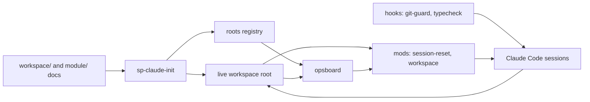

# project-harness plan

Updated 2026-10-16. This plan holds the work left on project-harness itself: tracks, open
steps, releases and the decisions they rest on. Setup copies only `workspace/` and
`module/` into a new workspace, never this file. What is built is described in
[WORKFLOW.md](WORKFLOW.md) and the [CHANGELOG](CHANGELOG.md); how, in git log.

## Contents

1. [What project-harness is](#what-project-harness-is)
2. [How it fits together](#how-it-fits-together)
3. [Components and ownership](#components-and-ownership)
4. [Tracks and order](#tracks-and-order)
5. [Tracker: open steps](#tracker-open-steps)
6. [Releases and versions](#releases-and-versions)
7. [Rules for this repository](#rules-for-this-repository)
8. [Decisions](#decisions)

## What project-harness is

A template and its tooling for running a coordinated super project: a root repository with
module submodules, several Claude Code sessions in parallel, each the only writer of its
repositories, git only after the operator's approve, and one checkpoint per milestone.
The docs and the tooling that reads them (mods, hooks, ops board, bootstrap, skill
templates) live here; `tooling/install` links the tooling into `~/.claude` and `BIN_DIR`,
so the checkout is the running copy. `/autopilot` ([AUTOPILOT.md](AUTOPILOT.md)) lets a
session approve its own reviewed commits until a target, and stop for the operator's
decisions.

**Defaults:**
- Build only what a live workspace needs.
- One operator, Linux, Claude Code. Packaging, a plugin marketplace, macOS and other
  agents are deferred.
- Personal values (paths, registered roots, private strings, signing) live in local
  config, never in the repository.
- Public since v0.1.0 (2026-10-11) and developed in the open ([D11](#decisions)). The
  history before v0.1.0 stays in the archived private repository.

## How it fits together

- **Docs** (`workspace/`, `module/`): the files and headings the tooling parses, the docs
  contract in [WORKFLOW.md](WORKFLOW.md) section 3.
- **Bootstrap** (`sp-claude-init`): checks the contract, copies the project skills and
  registers the root.
- **Ops board** (`opsboard`): the one parser of `operator.md` and `handoffs.md`; the
  workspace mod reads its `--tsv` output.
- **Mods**: session-reset gates git on the operator's approve and restarts the session
  after a commit; workspace guards writes by session and shows the band and the `/ops`
  pane.
- **Hooks**: git-guard blocks destructive git; typecheck sends Claude back on a failing
  type check.

## Components and ownership

One track writes each component at a time. Every component but DESK lives under
`tooling/`, and `tooling/install` links it to the path it runs from ([WORKFLOW.md](WORKFLOW.md)
section 1). DESK's plugin stays in `claude-desktop/`, which each project loads as a local
marketplace.

| Code | Component | Owns | Tracks left |
|---|---|---|---|
| DOC | Template docs | README, WORKFLOW, SETUP, `workspace/`, `module/` | T5 |
| MOD | Mods | session-reset, workspace | T7, then T2 |
| BIN | Scripts | opsboard, sp-claude-init, session-sweep, commit-all, push-all, leak-check, publish-check, gh-harden | T7 |
| HOOK | Hooks | git-guard, typecheck, the pre-push hook | — |
| SKL | Skills and commands | skill templates, `/session`, `/operator-steps` | T2 |
| ENG | Engineering skills | `tooling/global-skills/`, `tooling/agents/`, their lines in `tooling/install` | T5, then T7 |
| PUB | Publishing | `tooling/publish/` (templates, rulesets) | — |
| DESK | Desktop way of working | `claude-desktop/` (the `desk` plugin), `tooling/bin/sp-claude-desktop` | T8 |

## Tracks and order

Three sessions work here, each a plain session in this repository (it is not a registered
root), and no component is written by two ([D17](#decisions), [D18](#decisions)). Each
runs its tracks in the order below, so each track finishes before that session's next one
starts.

| Session | Auto mode | Tracks, in order |
|---|---|---|
| **H1** | yes | T6, then T5 |
| **H2** | never: it edits session-reset | T3 (BOARD-4.5), then T7, then T2 |
| **H3** | yes | T8 |

| Track | Goal | Milestone | Release |
|---|---|---|---|
| **T3 Session board** | The ops board shows each session ID: live or not, working, waiting or idle, since when | M4 | v0.3.0 |
| **T6 Engineering skills** | pstack's engineering skills, adapted to Claude Code and the git rules, installed as global skills: principles, verification with a test budget, writing, review, understanding, lessons into checks, trails, and the `/rigor` mode with its playbooks | M6 | in ship order |
| **T5 Code cleanup** | `/code-cleanup` runs a full maintenance pass on a repository: fewer, truer comments, simpler code, only the tests that matter, and a verdict on its design | M5 | in ship order |
| **T7 PR mode** | A second mode beside approve mode: a session works in its own worktree, each step ends in a PR a verifier on another model checks, and the operator merges | M7 | in ship order |
| **T2 Commit loop** | Every approve whose commands succeed ends in a session restart | M3 | in ship order |
| **T8 Desktop** | A second way of working, apart from the harness, for projects run in the Claude desktop app: one task, one worktree, one PR; skills as the `desk` plugin; `sp-claude-desktop` turns the harness off in one project | M8 | in ship order |

T1 Public (M1) is done: v0.1.0 and v0.1.1. T4 Autopilot (M2) is done: v0.2.0.

T2 pauses after LOOP-3.2. T7 starts with the spike D14 asked for: sessions working in
their own worktrees, or as cloud sessions, each step ending in a PR the operator merges,
with conflicts solved at the merge instead of files owned per session. It decides how
much of T2's runner (LOOP-3.3 to 3.6) is still needed.

When H2 needs a DOC edit before H1 releases DOC, it writes it in PRMODE.md, which T7
creates and owns.

**Waiting on the operator:** the `O<n>` tasks, under "Open operator tasks" in the tracker.

## Tracker: open steps

Priorities: **P0** critical path, **P1** required but parallel, **P2** only for a named
need. Step IDs are `<CODE>-<milestone>.<n>`, never renumbered or reused; the next
operator task is O11.

**Open operator tasks:**
- O10 (unblocks DESK-8.5): run `sp-claude-desktop <project>` on a test project (with
  `--modules` when its modules are submodules), then `/desk:adopt` if it was planned for
  the harness. Do the three checks under "Not checked yet" in
  [claude-desktop/README.md](claude-desktop/README.md) in the desktop app. Then tell H3
  "O10 done", with any check that failed.

**Next:** H1: CLEAN-5.2, and ENG-6.12 once Gate M6 passes. H2: the BOARD-4.4 fixes from H1's `/interrogate`, then PR-7.3 (out of auto mode), and BOARD-4.5 once Gate M4 passes. H3: DESK-8.5 once O10 is done.

**Notes.**
- The publish skills (`go-public`, `publish`) were checked by reading, not on a fixture
  workspace. The first real `/go-public` is their run.
- Edits to the session-reset mod get no verdict from auto mode's check; make them outside
  auto mode (session H2).
- From pstack, T6 leaves out `setup-pstack` (Cursor's model config), `make-bot-ui` (Grok
  bot webhooks) and the `benny` pack (Cursor automations triaging Slack). benny can come
  back as a `/schedule` routine when a workspace needs it.
- GitHub drops parameters it does not use from a stored ruleset (`update` on a tag
  ruleset keeps none), so a ruleset file holds only what GitHub keeps, or `gh-harden`
  reads it as different forever.
- Elsewhere, not in this repository: a workspace planned under the old export model
  (`<repo>-oss` names, `PUBLISHED_DIR`, its own copies of the publish skills) moves to D11
  after `sp-update` brings it v0.1.1. There, `/go-public <repo>` plans each module again,
  and the operator decides the names and any module paths that named `-oss`.

### T2 Commit loop (M3)

Why: an approved commit often does not clear and restart the session. The replay
(`node tooling/mods/session-reset/replay.mjs [--list]`) runs the local transcripts through
the mod as it stands. A preview from before the commit block (LOOP-3.2) gets one, each
line pinned to the directory the same command ran in, and each recorded git write is
pinned the same way, as a model that keeps the contract would type it; a model that does
not shows only in the live log. Before the commit block, 92 of 213 approves of a
committing preview in a workspace session ended with no restart, 42 of them on a `cd` the
preview did not show. With it, on 2026-10-15, 98 of 241 did. What is left, most first:
- **Denied when recorded (44).** An older gate denied a command the current one lets run,
  so the replay cannot tell how the turn would have gone.
- **Chained differently from the preview (28).** A read (`git log -1`, `git diff --stat`)
  chained onto the writes, or the writes chained in another order.
- **Nothing left to commit (11).** Another session had already committed the shared root
  file whole, so `git commit` exits 1, the preview counts as failed, and a re-approve fails
  the same way.
- **The rest:** no git write in the approved turn (9), signing failures (3), git commands
  after the preview ran (2), and a turn that ran 2 of 4 commands (1).

Another 25 approves found no open preview: the answer showed none or reported a failure.
The commit block rule would have refused 6 previews: `add -A` or `.` (3), `commit-all`
(1), a note (1) and a wrapper before git (1). Outside workspace sessions the same causes
recur, plus a tool's name in a command that is not git: copying the `commit-all` and
`push-all` scripts with `cp` was denied. The replay counts each turn under its first
cause.

The fix (decision D2): the model stops retyping git commands. On a plain approve, the mod
runs the preview itself.

| Done | Pri | Step | Depends on | Done when |
|---|---|---|---|---|
| [ ] | P0 | LOOP-3.3: Runner. First a spike: how a mod hands output back to the conversation. Then, on a plain approve, the mod runs the block in order with `$.process.run`, with a timeout long enough for the signing prompt. It stops at the first failure and gives the model the failing command and output to report; on success it restarts. Git writes typed by the model stay denied | — | A two-repository preview runs and restarts in a live workspace |
| [ ] | P0 | LOOP-3.4: Empty commit. Before each `git commit`, if the paths from its `git add` have no diff against HEAD and nothing is staged, record "already committed in `<hash>`" and continue | LOOP-3.3 | The fixture of a root file committed by another session restarts |
| [ ] | P1 | LOOP-3.5: Recovery. A re-approve resumes at the failed command. `/committed` restarts only after a git check: the preview's paths are clean and each repository's HEAD moved, or the path was already committed. Relax its doubt filter. The band shows "preview n/m ran, failed at …" | LOOP-3.3 | Tests for each path |
| [ ] | P0 | LOOP-3.6: Fixtures for every failure class: empty root commit, wrong directory, signing failure, diff lines in the preview, an unbalanced apostrophe, several roots, template tag lines, a tool name in a non-git command | LOOP-3.4 | The replay restarts after every approve whose commands succeed; one week of live use confirms it from the log |
| [ ] | P1 | LOOP-3.7: Docs (WORKFLOW.md lifecycle, git rules), CHANGELOG, release | LOOP-3.6 | v0.5.0 tagged |

- [ ] **Gate M3:** one week of live use with no missed restart in the log → v0.5.0.

### T3 Session board (M4)

Why: the operator cannot see which sessions are running, which are idle and which wait
for an approve. Claude Code's own per-process records (`~/.claude/sessions/<pid>.json`)
already give `busy`, `idle` or `waiting`, the Claude session and liveness (`pid` and
`procStart`). session-reset's registry (BOARD-4.1) says which `/session <ID>` each Claude
session runs: `~/.local/state/super-project/sessions/<Claude session>.json`. `opsboard`
and `/ops` join the two; the old attention files (`~/.cache/agents`) are retired.

| Done | Pri | Step | Depends on | Done when |
|---|---|---|---|---|
| [ ] | P1 | BOARD-4.5: Release v0.3.0: the CHANGELOG heading, the tag and the GitHub Release | Gate M4 | v0.3.0 tagged |

- [ ] **Gate M4:** the board matches the running sessions for a week (2026-10-16 to
  2026-10-23) → v0.3.0.

### T6 Engineering skills (M6)

Why: the harness says when a session may commit, but little about how well it works.
pstack (`cursor/plugins`, `pstack/`, MIT) is one engineer's set of skills for rigorous
work, and most of it is prose that ports to Claude Code. T6 brings in the parts that fit
approve mode. The parts that need PRs come with T7.

How each skill is ported:
- It goes in `tooling/global-skills/<name>/`, and `tooling/install` links it to
  `~/.claude/skills/<name>`. An agent goes in `tooling/agents/`. These skills serve this
  repository and every workspace; `tooling/skills/` keeps only workspace-workflow skills.
- Fewer, larger skills, because every skill's description loads into each session: one
  `principles` skill with a reference per principle, and one mode skill whose playbooks
  are references.
- Cursor's `Task` becomes the Agent tool, and "another model family" becomes another
  Claude model (opus, sonnet, haiku, fable). The Cursor-only parts go: the model rule
  file, Grok, `cursor-team-kit`, the control skills and `create-skill`. Transcripts are
  `~/.claude/projects/<cwd slug>/*.jsonl`.
- Git defers to `git-rules.md`: nothing is committed, pushed or opened outside a preview,
  and subjects keep the `<ID or area>: …` style.
- The prose is rewritten in this repository's plain style, and each SKILL.md ends with a
  line crediting pstack ([tooling/global-skills/LICENSE-pstack](tooling/global-skills/LICENSE-pstack)).

**The test budget.** pstack's habit of proving the change on the real thing comes in,
but tests must not pile up. A test stays only if it fails when the behaviour breaks and
passes when only the internals change. Each feature gets one end-to-end path, plus tests
for its tricky logic. A new test either replaces an old one or says in the preview why
it is needed.

| Done | Pri | Step | Depends on | Done when |
|---|---|---|---|---|
| [ ] | P1 | ENG-6.12: Release: the CHANGELOG heading, the tag and the GitHub Release, in ship order | Gate M6 | Tagged |

- [ ] **Gate M6:** `/rigor` and `/interrogate` used on real work in a workspace, and the
  operator keeps them → release.

### T5 Code cleanup (M5)

Why: sessions add code step by step, and nothing ever takes a step back. Comments go
stale, tests pile up on obvious code, helpers duplicate each other and the abstractions
drift from what the code does now. `/code-cleanup [<repo or path>]` is the maintenance
pass that takes that step back, inside Claude Code like the other commands.

What the pass does, in this order:
- **Comments:** keep only those that say why (a workaround, a constraint, a non-obvious
  choice); remove those that restate the code, narrate history or no longer hold.
- **Clutter and staleness:** dead code, unused options and files, leftovers of dropped
  designs, docs that describe what no longer exists.
- **Duplication:** merge copies only when they must change together; two identical pieces
  that will evolve apart stay apart.
- **Simplify and refactor:** shorter paths, fewer layers, plain names; behaviour stays the
  same.
- **Tests:** keep the end-to-end tests and those for tricky logic; remove tests of obvious
  code and simplify the rest.
- **Design:** evaluate the abstractions, architecture and design. Small fixes go into the
  pass; anything that changes the design is a proposal for the operator, written as new
  plan steps, never applied on its own.

Each area is its own reviewed commit (`code-review`, then a preview), so `/autopilot` can
run the pass and stops at the design proposals.

The passes use T6's skills: comments through `no-comments` and the `comment-sicko`
agent, tests through the two-edit check of `test-behavior-not-implementation` and the
test budget, simplify and design through `interrogate`'s code-quality lens, and every
removal proved safe with `blast-radius`.
`code-cleanup` is a global skill (`tooling/global-skills/code-cleanup/`), not a project
skill: it is general engineering, and its first run is on this repository, where
`sp-claude-init` installs nothing.

| Done | Pri | Step | Depends on | Done when |
|---|---|---|---|---|
| [ ] | P0 | CLEAN-5.2: First run on this repository, then on a real workspace module; fix the skill from what it got wrong | — | Both runs end with the tests passing and the operator agrees with what was removed |
| [ ] | P1 | CLEAN-5.3: CHANGELOG, release | CLEAN-5.2 | Tagged |

- [ ] **Gate M5:** `/code-cleanup` runs on a real workspace module, its commits pass review
  and the operator keeps them → release.

### T7 PR mode (M7)

Why: in approve mode every commit waits for the operator, and sessions own files so they
never collide. pstack works the other way: each agent has its own branch, opens a PR,
another model verifies it, and conflicts are solved at the merge. T7 adds that as a
second mode, the way `/autopilot` was added, and is the spike D14 asked for. Approve mode
stays as it is. In PR mode a session commits freely on its own branch in its own
worktree. The gate moves to the PR: a verifier's verdict, then the operator's merge. One
writer owns the stack's topology (pstack's autopilot-stack).

| Done | Pri | Step | Depends on | Done when |
|---|---|---|---|---|
| [ ] | P0 | PR-7.3: session-reset in PR mode ([PRMODE.md](PRMODE.md)): `/pr [on\|off]` in its session state, the gate of section 4 (what runs with no approve, from a preview, or never), the `Review:` line on a `gh pr create` preview, and the restart once the PR opens. First check that a submodule's worktree is sound (D16) | — | Tests for each allowed and refused command (gate logic, so within the budget) |
| [ ] | P0 | PR-7.4: workspace mod: the write guard by worktree in PR mode; the band shows the step's PR and its verdict | PR-7.3 | A live workspace session runs in PR mode |
| [ ] | P1 | PR-7.5: opsboard: PR and verdict columns (`gh pr list`), and `--worktrees`, a read-only audit after pstack's `worktree-audit.sh` that never deletes | PR-7.3 | `opsboard --md` shows them on a live workspace |
| [ ] | P1 | PR-7.6: The PR playbooks as references of `rigor`: babysit (CI, review threads, conflicts; run under `/loop`), shipping, opening a PR (in this repository's subject style), autopilot-stack, orchestrate, worktree cleanup, autonomous run | ENG-6.10 | `/rigor` babysits a real PR to green |
| [ ] | P1 | PR-7.7: Docs, CHANGELOG, release. Then answer D14: how much of T2's runner is still needed | PR-7.6 | Tagged |

- [ ] **Gate M7:** a workspace session runs a step to a merged PR in PR mode → release.

### T8 Desktop (M8)

Why: the harness fits several terminal sessions that the operator approves one commit at
a time. Several projects at once in the Claude desktop app need less: each task gets its
own session, worktree, branch and PR, and the operator reviews at the merge. T8 builds
that as a separate way of working, with no commit gate, and leaves the harness as it is.
[claude-desktop/README.md](claude-desktop/README.md) describes it.

- `sp-claude-desktop <project>` writes the project's `.claude/settings.local.json`. It
  turns off the mods (`<name>@inline: false`) and every hook (`disableAllHooks`). It skips
  `~/.claude/CLAUDE.md` and its imports (`claudeMdExcludes`), and turns off the user
  skills, commands (`skillOverrides`) and agents (`permissions.deny`). It installs the
  `desk` plugin at local scope from `claude-desktop/` as a directory marketplace.
  Checked in headless sessions with 2.1.302; the desktop app is O10.
- Plugin skills are namespaced (`desk:<name>`) and `skillOverrides` does not touch them,
  so they never clash with the global skills of the same name.
- The `desk` skills are copies, not links. T6's skills keep the harness lines, so H3
  never edits `tooling/global-skills/` and copies a change by hand when one is worth it.

| Done | Pri | Step | Depends on | Done when |
|---|---|---|---|---|
| [ ] | P1 | DESK-8.5: The mode skill `desk:desk`, a router ported from pstack's poteto-mode. Playbooks: feature, bug fix, investigation, refactoring, session pickup, pause safely, opening a PR, perf issue, hillclimb, babysit (CI and review threads, under `/loop`), shipping, autonomous run, and worktree cleanup with `worktree-audit.sh`. Keep the "Subagents" and "Principles" sections and the playbook names that the ported skills cite. PRs open with no preview, in the repository's subject style and with no trailer. Add the `desk:delegate` agent, ported from pstack's `poteto-agent`, for the mode skill's subagents | O10 | `/desk:desk` takes a small bug in the test project to an open, verified PR |
| [ ] | P1 | DESK-8.6: A line in the root README pointing to `claude-desktop/README.md`; CHANGELOG, release | DESK-8.5 | Tagged |

- [ ] **Gate M8:** the operator works one real project through the desktop app for a
  week and keeps the setup → release.

## Releases and versions

- Each milestone is the next `v0.<n>.0`, in the order they ship (D14, D17): an annotated, signed tag whose notes list the
  capabilities, and a GitHub Release (`gh release create <tag> --verify-tag
  --notes-from-tag`, run inside the checkout: it refuses `-R`). A patch version `v0.<m>.
` carries fixes
  and small tooling between milestones.
- Work lands on `development`, the default branch. A release fast-forwards `main` to the
  release commit once CI has passed on it, and the tag goes on that commit. `main` is
  always the latest release; README installs from it.
- Pull requests target `development`. Merge commits or squash; never a rebase merge,
  which drops the signature.
- Nobody force-pushes or rewrites `main` or `development`.
- session-reset counts `git tag -v`, `git fetch` and `gh api` as writes, so they run from
  a preview; `gh run view` and `gh run watch` are reads.
- CI pins Claude Code to the version the mods are written for (2.1.296; 2.1.283 fails to
  load the workspace mod).

## Rules for this repository

- **Everything here is public.** Every push is public at once, this plan included: no
  private names or paths, no workspace names, personal folders, transcript IDs, captured
  data or secrets, and commit messages stay neutral. The pre-push hook runs leak-check;
  CI runs it over the tree and the history.
- **Personal values only in local config.** Workspace-specific behaviour only through
  `.claude/workspace.json` or an overlay. Never in the repository: the config file, the
  roots registry, the private-strings list, the overlay, `~/.claude/settings.json` and
  the personal lines of `~/.claude/CLAUDE.md`.
- **The docs contract moves as one.** A change to a parsed file or heading updates
  WORKFLOW.md section 3 and the parsers in the same commit.
- **Git** follows the global rules: `code-review` on the diff, a preview with its
  `Review:` line, then the operator's approve.

## Decisions

| ID | Decision | Date |
|---|---|---|
| D1 | Repository layout and local config: install links each file to the path it runs from; one `KEY=value` config file read through `sp-config`; data rules in `.claude/workspace.json`, code rules and private skills in the overlay ([WORKFLOW.md](WORKFLOW.md) section 1) | 2026-10-10 |
| D2 | The session-reset mod runs the approved preview itself; the model no longer retypes git commands | 2026-10-10 |
| D4 | The public repository holds the docs and the tooling, under MIT | 2026-10-10 |
| D8 | T4 Autopilot comes right after T1 as M2 (v0.2.0); T2 becomes M3 and T3 M4. Their steps were renumbered once for it (`LOOP-3.n`, `BOARD-4.n`), the one exception to "never renumbered" | 2026-10-11 |
| D9 | A new project is set up from one file: the `new-project` skill interviews the operator in one batch and writes `.claude/project.toml` (or the operator edits it), and `sp-new` renders every root and module document from it. Agents no longer fill tokens by hand across the docs | 2026-10-11 |
| D11 | Develop in the open. A repository goes public under its own name and is developed there: in place when its history is clean, else one audited snapshot in a new repository of that name, with the old one renamed `<repo>-private` and archived. The gates are local (`publish-check`, the pre-push hook) and on GitHub (`gh-harden`); `/go-public <repo>` plans the whole release ([WORKFLOW.md](WORKFLOW.md) section 4). This repository was the first. Replaces D10, the export to a `<repo>-oss` copy | 2026-10-12 |
| D12 | The repository is `project-harness`: the harness a super project's sessions run in. "Super project" stays the name of what it runs (a root and its module submodules), so the `sp-*` commands and the `super-project` folders keep their names | 2026-10-12 |
| D13 | Autopilot is a command in one session, not a driver: `/autopilot [<step>] [--max N]` makes session-reset approve that session's previews itself until the step's commit, the session's checkpoint preconditions or N commits (100 by default). It approves only reviewed `git add` and `git commit` previews, so nothing is pushed; a question, a failure or anything else waits for the operator. Every step, in both modes, is reviewed before its commit and cleans up its docs after it. Only the setup scripts run outside Claude Code. Replaces D5 (a mode per workspace), D6 (worktrees, PRs, merges) and D7 (`policy.md`, `inbox.md`) ([AUTOPILOT.md](AUTOPILOT.md)) | 2026-10-13 |
| D14 | T3 and T5 come before the rest of T2. T2 pauses after LOOP-3.2 for a spike on worktrees and PRs after T5 (sessions in their own worktrees or in the cloud, each step a PR, conflicts solved at the merge), which reopens D6 and decides how much of D2's runner is still needed. Releases are numbered in the order they ship: M4 is v0.3.0, M5 v0.4.0, M3 v0.5.0; step IDs keep their milestone | 2026-10-15 |
| D15 | Every workspace session keeps the root docs (the root's `.md` files outside the module repositories) current as its work goes and leaves them uncommitted; the operator or `CP<m>` commits the root in one commit, and sessions push only when a step needs it. Root docs that only a checkpoint could change drifted from the work. The workspace mod lets every session write them; submodule pins and tags stay with `CP<m>` | 2026-10-16 |
| D16 | PR mode (T7), from the PR-7.1 spike. **Where:** a local worktree per session and repository, `<root>/.worktrees/<ID>/<repo>` (gitignored by the root), made once from a preview (`git -C <root>/<repo> worktree add <root>/.worktrees/<ID>/<repo> -b <ID>/<step> origin/development # approved`). The session stays at the root, writes by absolute path and pins git with `-C`, so it can hold several repositories; Claude Code's own `EnterWorktree` and `claude -w` move a session into one repository only, and cloud sessions carry neither the mods nor the private submodules, so both wait. PR-7.3 first checks that a submodule's worktree is sound (its shared `core.worktree`); if not, the worktree is a clone of the module repository at the same path. **Branches:** one per step, `<ID>/<step>`, from `origin/development`, or from the session's previous step branch when the step builds on an unmerged PR (a stack the session alone shapes); a conflict is solved by merging `development` into the branch, never a rebase or a force-push. **Mode:** `/pr [on\|off]` in a `/session`, kept in session-reset's session state over restarts like `/autopilot`, shown in the band; a workspace can mix modes. **What runs:** in the session's own worktrees, with no approve: `add`, `commit`, `switch -c <ID>/…`, `fetch`, `merge origin/development`, and `push origin <ID>/…` without force or delete. From a preview: the first `worktree add`, its `worktree remove`, and `gh pr create --base development --head <ID>/<step>` and `gh pr comment` on the session's own PR; autopilot may approve the two `gh` commands. Never: a merge into `development` or `main`, a push to another branch, a force-push, a retarget; the main checkouts stay in approve mode. **Step end:** the session spawns a verifier on another model on the pushed head (`interrogate`, then prove-it-works on the real artifact), puts its verdict and the head SHA in the PR body and a ledger row, opens the PR, and restarts with `/session <ID>`; the operator merges on GitHub. The write guard allows the session its own `.worktrees/<ID>/` and the root docs (D15), so two sessions may change one repository and meet at the merge. A checkpoint's release commit is a merged commit on `development`. [PRMODE.md](PRMODE.md) holds the details | 2026-10-16 |
| D17 | pstack's engineering skills come in as global skills (`tooling/global-skills/`, linked into `~/.claude/skills/`), adapted to Claude Code and the git rules (T6). What needs PRs comes as PR mode, a second mode beside approve mode (T7). Tests follow a budget: verification on the real artifact, tests that catch real breaks, no pile-up. Two sessions work here: H1 in auto mode (T6, T5), H2 never in auto mode (session-reset: T3, T7, T2). Releases stay numbered in the order they ship, so D14's version numbers for M5 and M3 no longer hold | 2026-10-16 |
| D18 | A second way of working for the Claude desktop app, apart from the harness (T8): one task, one session, one worktree, one PR, and the operator's merge as the only gate. No commit gate, no `/session`, no docs contract. `sp-claude-desktop <project>` turns the harness off in one project through its `settings.local.json`; every other project keeps it. The skills ship as the `desk` plugin in `claude-desktop/`, copied from T6 with the harness lines removed or ported again from pstack, so T6 and T8 never share a file. A third session, H3, owns T8 | 2026-10-17 |
