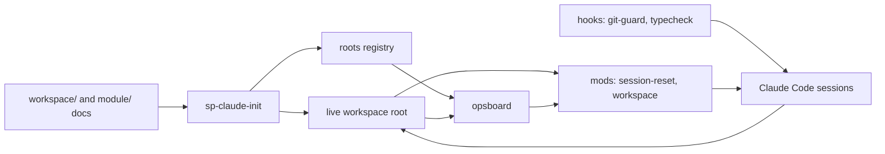

# project-harness plan

Updated 2026-10-13. This plan holds the work left on project-harness itself: tracks, open
steps, releases and the decisions they rest on. Setup copies only `workspace/` and
`module/` into a new workspace, never this file. What is built is described in
[WORKFLOW.md](WORKFLOW.md) and the [CHANGELOG](CHANGELOG.md); how, in git log.

## Contents

1. [What project-harness is](#what-project-harness-is)
2. [How it fits together](#how-it-fits-together)
3. [Components and ownership](#components-and-ownership)
4. [Tracks and order](#tracks-and-order)
5. [Tracker: open steps](#tracker-open-steps)
6. [Releases and versions](#releases-and-versions)
7. [Rules for this repository](#rules-for-this-repository)
8. [Decisions](#decisions)

## What project-harness is

A template and its tooling for running a coordinated super project: a root repository with
module submodules, several Claude Code sessions in parallel, each the only writer of its
repositories, git only after the operator's approve, and one checkpoint per milestone.
The docs and the tooling that reads them (mods, hooks, ops board, bootstrap, skill
templates) live here; `tooling/install` links the tooling into `~/.claude` and `BIN_DIR`,
so the checkout is the running copy. [T4](#t4-autopilot-m2) adds
`/autopilot`: a session approves its own reviewed commits until a target, and stops
for the operator's decisions.

**Defaults:**
- Build only what a live workspace needs.
- One operator, Linux, Claude Code. Packaging, a plugin marketplace, macOS and other
  agents are deferred.
- Personal values (paths, registered roots, private strings, signing) live in local
  config, never in the repository.
- Public since v0.1.0 (2026-10-11) and developed in the open ([D11](#decisions)). The
  history before v0.1.0 stays in the archived private repository.

## How it fits together

- **Docs** (`workspace/`, `module/`): the files and headings the tooling parses, the docs
  contract in [WORKFLOW.md](WORKFLOW.md) section 3.
- **Bootstrap** (`sp-claude-init`): checks the contract, copies the project skills and
  registers the root.
- **Ops board** (`opsboard`): the one parser of `operator.md` and `handoffs.md`; the
  workspace mod reads its `--tsv` output.
- **Mods**: session-reset gates git on the operator's approve and restarts the session
  after a commit; workspace guards writes by session and shows the band and the `/ops`
  pane.
- **Hooks**: git-guard blocks destructive git; typecheck sends Claude back on a failing
  type check.

## Components and ownership

One track writes each component at a time. Every component lives under `tooling/`, and
`tooling/install` links it to the path it runs from ([WORKFLOW.md](WORKFLOW.md)
section 1).

| Code | Component | Owns | Tracks left |
|---|---|---|---|
| DOC | Template docs | README, WORKFLOW, SETUP, `workspace/`, `module/` | T4 |
| MOD | Mods | session-reset, workspace | T4, then T2, then T3 |
| BIN | Scripts | opsboard, sp-claude-init, session-sweep, commit-all, push-all, leak-check, publish-check, gh-harden | T4, then T3 |
| HOOK | Hooks | git-guard, typecheck, the pre-push hook | — |
| SKL | Skills and commands | skill templates, `/session`, `/operator-steps` | T4, then T2 |
| PUB | Publishing | `tooling/publish/` (templates, rulesets) | — |

## Tracks and order

One session at a time works here, from a plain session in this repository; it is not a
registered root. The tracks run in the order of the table below (T4 comes before T2,
[D8](#decisions)), so each finishes before the next starts.

| Track | Goal | Milestone | Release |
|---|---|---|---|
| **T4 Autopilot** | A session on `/autopilot` commits its reviewed steps alone until a target; the operator only answers questions and does operator tasks | M2 | v0.2.0 |
| **T2 Commit loop** | Every approve whose commands succeed ends in a session restart | M3 | v0.3.0 |
| **T3 Session board** | The ops board shows each session ID: live or not, working, waiting or idle, since when | M4 | v0.4.0 |

T1 Public (M1) is done: v0.1.0 and v0.1.1.

**Waiting on the operator:** the `O<n>` tasks, under "Open operator tasks" in the tracker.

## Tracker: open steps

Priorities: **P0** critical path, **P1** required but parallel, **P2** only for a named
need. Step IDs are `<CODE>-<milestone>.<n>`, never renumbered or reused; the next
operator task is O10.

**Open operator tasks:**
- **O4:** raise the signing agent's auto-lock time from 15 minutes to a few hours. It
  already keeps an approval until it locks, but it locks after 15 idle minutes, and then
  the next autopilot commit waits at the unlock prompt. Unblocks: AUTO-2.12. When:
  before AUTO-2.12.

**Next:** AUTO-2.12; its live run waits for O4.

**Notes.**
- The publish skills (`go-public`, `publish`) were checked by reading, not on a fixture
  workspace. The first real `/go-public` is their run.
- Edits to the session-reset mod get no verdict from auto mode's check; make them outside
  auto mode.
- GitHub drops parameters it does not use from a stored ruleset (`update` on a tag
  ruleset keeps none), so a ruleset file holds only what GitHub keeps, or `gh-harden`
  reads it as different forever.
- Elsewhere, not in this repository: a workspace planned under the old export model
  (`<repo>-oss` names, `PUBLISHED_DIR`, its own copies of the publish skills) moves to D11
  after `sp-update` brings it v0.1.1. There, `/go-public <repo>` plans each module again,
  and the operator decides the names and any module paths that named `-oss`.

### T4 Autopilot (M2)

Why: in the operated workflow the operator approves every commit, so a session waits
whenever they look away. They want to own the vision and the decisions, and let a
session run its steps alone until a target, stopping only when it needs them.

The design is [AUTOPILOT.md](AUTOPILOT.md) ([D13](#decisions)): `/autopilot [<step>]
[--max N]` in a session makes session-reset approve that session's previews itself,
until the step is committed, the session reaches its checkpoint preconditions, or N
commits ran (100 by default). It approves only reviewed previews of `git add` and
`git commit`; anything else, a question or a failure stops it. Nothing runs outside
Claude Code, and nothing is pushed. A step that changes the design updates that file in
the same commit. AUTO-2.2 to AUTO-2.10, the earlier design, were dropped by D13.

| Done | Pri | Step | Depends on | Done when |
|---|---|---|---|---|
| [ ] | P0 | AUTO-2.12: `/autopilot [<step>] [--max N]` and `/autopilot off` in session-reset: approve a preview that has a clean `Review:` line, only `git add` and `git commit`, within the count; stop at the target step's commit, at the session's `reached` row (from `opsboard --tsv`), at the count, on a failed command, `/clear` or `/resume`; the band shows it. The "under autopilot" go-ahead rule in `/session` and the Session rules. **O4** comes first | O4 | Mod tests for each approve and each stop; a live session runs three steps alone and stops at its target |
| [ ] | P0 | AUTO-2.13: Sessions on the board. opsboard parses the Session table, each session's queue, which steps are done and what blocks them; `--tsv` gets a `session` row per ID (state, next step, ready count, blocked by, checkpoint). session-reset writes each session's autopilot state (target, count, waiting) under `~/.local/state/super-project/`, and opsboard joins it. `/ops` and `--md` get the Sessions block | AUTO-2.12 | A fixture's `--tsv` gives the right state for a ready, a blocked, a reached and an autopilot session; seen in the pane |
| [ ] | P1 | AUTO-2.14: `/balance-sessions` on the workload: ready and blocked work per session, how many sessions to run for the next stretch, decision review; the drift check and cleanup kept as a fallback, each fix reported as a skipped cleanup | AUTO-2.13 | On a fixture it proposes different session counts for two different stretches |
| [ ] | P0 | AUTO-2.15: End to end: two sessions of a toy two-module workspace on `/autopilot` reach their `CP1` preconditions; the operator only answered questions. Then docs, CHANGELOG and the release | AUTO-2.12, AUTO-2.13, AUTO-2.14 | v0.2.0 tagged |

- [ ] **Gate M2:** in a toy workspace, sessions on `/autopilot` reach their `CP1`
  preconditions with every commit reviewed and nothing pushed; the operator only
  answered questions, then ran `CP1` by hand → v0.2.0.

### T2 Commit loop (M3)

Why: an approved commit often does not clear and restart the session. Replaying the
session-reset gate over past transcripts showed about 35 of 177 approves without a
restart, almost all at the root commit. Two causes account for most of them:
- **Nothing left to commit.** Another session had already committed the shared root file
  whole, so `git commit` exits 1, the preview counts as failed, and a re-approve fails the
  same way.
- **Wrong working directory.** Preview lines carry no directory, and the shell's
  directory persists from earlier work. The obvious fix, `cd <root> && …`, is denied as
  not matching the preview. The bare command fails, and one failure locks every later
  command.

The other causes: chaining that differs from the preview, annotated or template lines
that can never match, a reworded message, and fenced diff blocks parsed as commands. The
guard also reads a tool's name in any command as a call to that tool: copying the
`commit-all` and `push-all` scripts with `cp` was denied.

The fix (decision D2): the model stops retyping git commands. On a plain approve, the mod
runs the preview itself.

| Done | Pri | Step | Depends on | Done when |
|---|---|---|---|---|
| [ ] | P0 | LOOP-3.1: session-reset appends a JSONL log under `~/.local/state/`: preview, approve, each command and result, restart or the reason for none. A local replay script over transcripts serves as the regression harness; its data is never committed | M2 | The replay reproduces the failure classes above |
| [ ] | P0 | LOOP-3.2: Preview contract. Exactly one fenced block tagged `commit` holds the commands, each pinned to an absolute repository path (`git -C <abs>`, `gh` with `--repo`). Diffs and messages go in other blocks and are never parsed. A block with placeholders or annotations is rejected at preview time, with a toast. Update the git rules, `/session` and WORKFLOW.md | LOOP-3.1 | Parser tests pass |
| [ ] | P0 | LOOP-3.3: Runner. First a spike: how a mod hands output back to the conversation. Then, on a plain approve, the mod runs the block in order with `$.process.run`, with a timeout long enough for the signing prompt. It stops at the first failure and gives the model the failing command and output to report; on success it restarts. Git writes typed by the model stay denied | LOOP-3.2 | A two-repository preview runs and restarts in a live workspace |
| [ ] | P0 | LOOP-3.4: Empty commit. Before each `git commit`, if the paths from its `git add` have no diff against HEAD and nothing is staged, record "already committed in `<hash>`" and continue | LOOP-3.3 | The fixture of a root file committed by another session restarts |
| [ ] | P1 | LOOP-3.5: Recovery. A re-approve resumes at the failed command. `/committed` restarts only after a git check: the preview's paths are clean and each repository's HEAD moved, or the path was already committed. Relax its doubt filter. The band shows "preview n/m ran, failed at …" | LOOP-3.3 | Tests for each path |
| [ ] | P0 | LOOP-3.6: Fixtures for every failure class: empty root commit, wrong directory, signing failure, diff lines in the preview, an unbalanced apostrophe, several roots, template tag lines, a tool name in a non-git command | LOOP-3.4 | The replay restarts after every approve whose commands succeed; one week of live use confirms it from the log |
| [ ] | P1 | LOOP-3.7: Docs (WORKFLOW.md lifecycle, git rules), CHANGELOG, release | LOOP-3.6 | v0.3.0 tagged |

- [ ] **Gate M3:** one week of live use with no missed restart in the log → v0.3.0.

### T3 Session board (M4)

Why: the operator cannot see which sessions are running, which are idle and which wait
for an approve. Claude Code's own per-process records (`~/.claude/sessions/<pid>.json`)
already give `busy`, `idle` or `waiting` and liveness. What is missing is a record on
disk of which `/session <ID>` each process runs. The old attention files in
`~/.cache/agents` have no working state, are never cleaned up and carry no session ID.

| Done | Pri | Step | Depends on | Done when |
|---|---|---|---|---|
| [ ] | P0 | BOARD-4.1: Session registry. session-reset writes `~/.local/state/super-project/sessions/<pid>.json` (`pid`, process start, Claude session, root, ID, time) on `/session` and on each restart. It clears it on a user `/clear` or `/resume`; a SessionEnd hook removes it | M3 | Files match the running sessions |
| [ ] | P0 | BOARD-4.3: Join process liveness into the `session` rows of AUTO-2.13: working, waiting for approval, waiting for input, idle since, or not running; two processes claiming one ID; checkpoint status and since; dirty repositories; open `O<n>` and handoffs addressed to it. Also list live sessions at a root with no ID. Output in `--tsv`, plain and `--md`. The Claude Code records are internal: one reader function, failing soft | BOARD-4.1, AUTO-2.13 | Matches a manual check of running sessions |
| [ ] | P1 | BOARD-4.4: The `/ops` Sessions block shows liveness: idle sessions first ("idle 25m, ready"); the band shows the count of idle sessions | BOARD-4.3 | Seen in the pane |
| [ ] | P1 | BOARD-4.5: Retire `~/.cache/agents`; docs, CHANGELOG, release | BOARD-4.4 | v0.4.0 tagged |

- [ ] **Gate M4:** the board matches the running sessions for a week → v0.4.0.

## Releases and versions

- Milestone M*m* is `v0.<m>.0`: an annotated, signed tag whose notes list the
  capabilities, and a GitHub Release (`gh release create <tag> --verify-tag
  --notes-from-tag`, run inside the checkout: it refuses `-R`). A patch version `v0.<m>.
` carries fixes
  and small tooling between milestones.
- Work lands on `development`, the default branch. A release fast-forwards `main` to the
  release commit once CI has passed on it, and the tag goes on that commit. `main` is
  always the latest release; README installs from it.
- Pull requests target `development`. Merge commits or squash; never a rebase merge,
  which drops the signature.
- Nobody force-pushes or rewrites `main` or `development`.
- session-reset counts `git tag -v`, `git fetch` and `gh api` as writes, so they run from
  a preview; `gh run view` and `gh run watch` are reads.
- CI pins Claude Code to the version the mods are written for (2.1.296; 2.1.283 fails to
  load the workspace mod).

## Rules for this repository

- **Everything here is public.** Every push is public at once, this plan included: no
  private names or paths, no workspace names, personal folders, transcript IDs, captured
  data or secrets, and commit messages stay neutral. The pre-push hook runs leak-check;
  CI runs it over the tree and the history.
- **Personal values only in local config.** Workspace-specific behaviour only through
  `.claude/workspace.json` or an overlay. Never in the repository: the config file, the
  roots registry, the private-strings list, the overlay, `~/.claude/settings.json` and
  the personal lines of `~/.claude/CLAUDE.md`.
- **The docs contract moves as one.** A change to a parsed file or heading updates
  WORKFLOW.md section 3 and the parsers in the same commit.
- **Git** follows the global rules: `code-review` on the diff, a preview with its
  `Review:` line, then the operator's approve.

## Decisions

| ID | Decision | Date |
|---|---|---|
| D1 | Repository layout and local config: install links each file to the path it runs from; one `KEY=value` config file read through `sp-config`; data rules in `.claude/workspace.json`, code rules and private skills in the overlay ([WORKFLOW.md](WORKFLOW.md) section 1) | 2026-10-10 |
| D2 | The session-reset mod runs the approved preview itself; the model no longer retypes git commands | 2026-10-10 |
| D4 | The public repository holds the docs and the tooling, under MIT | 2026-10-10 |
| D8 | T4 Autopilot comes right after T1 as M2 (v0.2.0); T2 becomes M3 and T3 M4. Their steps were renumbered once for it (`LOOP-3.n`, `BOARD-4.n`), the one exception to "never renumbered" | 2026-10-11 |
| D9 | A new project is set up from one file: the `new-project` skill interviews the operator in one batch and writes `.claude/project.toml` (or the operator edits it), and `sp-new` renders every root and module document from it. Agents no longer fill tokens by hand across the docs | 2026-10-11 |
| D11 | Develop in the open. A repository goes public under its own name and is developed there: in place when its history is clean, else one audited snapshot in a new repository of that name, with the old one renamed `<repo>-private` and archived. The gates are local (`publish-check`, the pre-push hook) and on GitHub (`gh-harden`); `/go-public <repo>` plans the whole release ([WORKFLOW.md](WORKFLOW.md) section 4). This repository was the first. Replaces D10, the export to a `<repo>-oss` copy | 2026-10-12 |
| D12 | The repository is `project-harness`: the harness a super project's sessions run in. "Super project" stays the name of what it runs (a root and its module submodules), so the `sp-*` commands and the `super-project` folders keep their names | 2026-10-12 |
| D13 | Autopilot is a command in one session, not a driver: `/autopilot [<step>] [--max N]` makes session-reset approve that session's previews itself until the step's commit, the session's checkpoint preconditions or N commits (100 by default). It approves only reviewed `git add` and `git commit` previews, so nothing is pushed; a question, a failure or anything else waits for the operator. Every step, in both modes, is reviewed before its commit and cleans up its docs after it. Only the setup scripts run outside Claude Code. Replaces D5 (a mode per workspace), D6 (worktrees, PRs, merges) and D7 (`policy.md`, `inbox.md`) ([AUTOPILOT.md](AUTOPILOT.md)) | 2026-10-13 |
