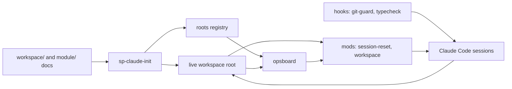

# project-harness plan

Updated 2026-10-15. This plan holds the work left on project-harness itself: tracks, open
steps, releases and the decisions they rest on. Setup copies only `workspace/` and
`module/` into a new workspace, never this file. What is built is described in
[WORKFLOW.md](WORKFLOW.md) and the [CHANGELOG](CHANGELOG.md); how, in git log.

## Contents

1. [What project-harness is](#what-project-harness-is)
2. [How it fits together](#how-it-fits-together)
3. [Components and ownership](#components-and-ownership)
4. [Tracks and order](#tracks-and-order)
5. [Tracker: open steps](#tracker-open-steps)
6. [Releases and versions](#releases-and-versions)
7. [Rules for this repository](#rules-for-this-repository)
8. [Decisions](#decisions)

## What project-harness is

A template and its tooling for running a coordinated super project: a root repository with
module submodules, several Claude Code sessions in parallel, each the only writer of its
repositories, git only after the operator's approve, and one checkpoint per milestone.
The docs and the tooling that reads them (mods, hooks, ops board, bootstrap, skill
templates) live here; `tooling/install` links the tooling into `~/.claude` and `BIN_DIR`,
so the checkout is the running copy. `/autopilot` ([AUTOPILOT.md](AUTOPILOT.md)) lets a
session approve its own reviewed commits until a target, and stop for the operator's
decisions.

**Defaults:**
- Build only what a live workspace needs.
- One operator, Linux, Claude Code. Packaging, a plugin marketplace, macOS and other
  agents are deferred.
- Personal values (paths, registered roots, private strings, signing) live in local
  config, never in the repository.
- Public since v0.1.0 (2026-10-11) and developed in the open ([D11](#decisions)). The
  history before v0.1.0 stays in the archived private repository.

## How it fits together

- **Docs** (`workspace/`, `module/`): the files and headings the tooling parses, the docs
  contract in [WORKFLOW.md](WORKFLOW.md) section 3.
- **Bootstrap** (`sp-claude-init`): checks the contract, copies the project skills and
  registers the root.
- **Ops board** (`opsboard`): the one parser of `operator.md` and `handoffs.md`; the
  workspace mod reads its `--tsv` output.
- **Mods**: session-reset gates git on the operator's approve and restarts the session
  after a commit; workspace guards writes by session and shows the band and the `/ops`
  pane.
- **Hooks**: git-guard blocks destructive git; typecheck sends Claude back on a failing
  type check.

## Components and ownership

One track writes each component at a time. Every component lives under `tooling/`, and
`tooling/install` links it to the path it runs from ([WORKFLOW.md](WORKFLOW.md)
section 1).

| Code | Component | Owns | Tracks left |
|---|---|---|---|
| DOC | Template docs | README, WORKFLOW, SETUP, `workspace/`, `module/` | T5 |
| MOD | Mods | session-reset, workspace | T3, then T2 |
| BIN | Scripts | opsboard, sp-claude-init, session-sweep, commit-all, push-all, leak-check, publish-check, gh-harden | T3 |
| HOOK | Hooks | git-guard, typecheck, the pre-push hook | — |
| SKL | Skills and commands | skill templates, `/session`, `/operator-steps` | T5, then T2 |
| PUB | Publishing | `tooling/publish/` (templates, rulesets) | — |

## Tracks and order

One session at a time works here, from a plain session in this repository; it is not a
registered root. The tracks run in the order of the table below, so each finishes
before the next starts.

| Track | Goal | Milestone | Release |
|---|---|---|---|
| **T3 Session board** | The ops board shows each session ID: live or not, working, waiting or idle, since when | M4 | v0.3.0 |
| **T5 Code cleanup** | `/code-cleanup` runs a full maintenance pass on a repository: fewer, truer comments, simpler code, only the tests that matter, and a verdict on its design | M5 | v0.4.0 |
| **T2 Commit loop** | Every approve whose commands succeed ends in a session restart | M3 | v0.5.0 |

T1 Public (M1) is done: v0.1.0 and v0.1.1. T4 Autopilot (M2) is done: v0.2.0.

T2 pauses after LOOP-3.2. After T5 comes a spike on worktrees and PRs: sessions working
in their own worktrees, or as cloud sessions, each step ending in a PR the operator
merges, with conflicts solved at the merge instead of files owned per session. It
decides how much of T2's runner (LOOP-3.3 to 3.6) is still needed (D14).

**Waiting on the operator:** the `O<n>` tasks, under "Open operator tasks" in the tracker.

## Tracker: open steps

Priorities: **P0** critical path, **P1** required but parallel, **P2** only for a named
need. Step IDs are `<CODE>-<milestone>.<n>`, never renumbered or reused; the next
operator task is O10.

**Open operator tasks:** none.

**Next:** BOARD-4.4.

**Notes.**
- The publish skills (`go-public`, `publish`) were checked by reading, not on a fixture
  workspace. The first real `/go-public` is their run.
- Edits to the session-reset mod get no verdict from auto mode's check; make them outside
  auto mode.
- GitHub drops parameters it does not use from a stored ruleset (`update` on a tag
  ruleset keeps none), so a ruleset file holds only what GitHub keeps, or `gh-harden`
  reads it as different forever.
- Elsewhere, not in this repository: a workspace planned under the old export model
  (`<repo>-oss` names, `PUBLISHED_DIR`, its own copies of the publish skills) moves to D11
  after `sp-update` brings it v0.1.1. There, `/go-public <repo>` plans each module again,
  and the operator decides the names and any module paths that named `-oss`.

### T2 Commit loop (M3)

Why: an approved commit often does not clear and restart the session. The replay
(`node tooling/mods/session-reset/replay.mjs [--list]`) runs the local transcripts through
the mod as it stands. A preview from before the commit block (LOOP-3.2) gets one, each
line pinned to the directory the same command ran in, and each recorded git write is
pinned the same way, as a model that keeps the contract would type it; a model that does
not shows only in the live log. Before the commit block, 92 of 213 approves of a
committing preview in a workspace session ended with no restart, 42 of them on a `cd` the
preview did not show. With it, on 2026-10-15, 98 of 241 did. What is left, most first:
- **Denied when recorded (44).** An older gate denied a command the current one lets run,
  so the replay cannot tell how the turn would have gone.
- **Chained differently from the preview (28).** A read (`git log -1`, `git diff --stat`)
  chained onto the writes, or the writes chained in another order.
- **Nothing left to commit (11).** Another session had already committed the shared root
  file whole, so `git commit` exits 1, the preview counts as failed, and a re-approve fails
  the same way.
- **The rest:** no git write in the approved turn (9), signing failures (3), git commands
  after the preview ran (2), and a turn that ran 2 of 4 commands (1).

Another 25 approves found no open preview: the answer showed none or reported a failure.
The commit block rule would have refused 6 previews: `add -A` or `.` (3), `commit-all`
(1), a note (1) and a wrapper before git (1). Outside workspace sessions the same causes
recur, plus a tool's name in a command that is not git: copying the `commit-all` and
`push-all` scripts with `cp` was denied. The replay counts each turn under its first
cause.

The fix (decision D2): the model stops retyping git commands. On a plain approve, the mod
runs the preview itself.

| Done | Pri | Step | Depends on | Done when |
|---|---|---|---|---|
| [ ] | P0 | LOOP-3.3: Runner. First a spike: how a mod hands output back to the conversation. Then, on a plain approve, the mod runs the block in order with `$.process.run`, with a timeout long enough for the signing prompt. It stops at the first failure and gives the model the failing command and output to report; on success it restarts. Git writes typed by the model stay denied | — | A two-repository preview runs and restarts in a live workspace |
| [ ] | P0 | LOOP-3.4: Empty commit. Before each `git commit`, if the paths from its `git add` have no diff against HEAD and nothing is staged, record "already committed in `<hash>`" and continue | LOOP-3.3 | The fixture of a root file committed by another session restarts |
| [ ] | P1 | LOOP-3.5: Recovery. A re-approve resumes at the failed command. `/committed` restarts only after a git check: the preview's paths are clean and each repository's HEAD moved, or the path was already committed. Relax its doubt filter. The band shows "preview n/m ran, failed at …" | LOOP-3.3 | Tests for each path |
| [ ] | P0 | LOOP-3.6: Fixtures for every failure class: empty root commit, wrong directory, signing failure, diff lines in the preview, an unbalanced apostrophe, several roots, template tag lines, a tool name in a non-git command | LOOP-3.4 | The replay restarts after every approve whose commands succeed; one week of live use confirms it from the log |
| [ ] | P1 | LOOP-3.7: Docs (WORKFLOW.md lifecycle, git rules), CHANGELOG, release | LOOP-3.6 | v0.5.0 tagged |

- [ ] **Gate M3:** one week of live use with no missed restart in the log → v0.5.0.

### T3 Session board (M4)

Why: the operator cannot see which sessions are running, which are idle and which wait
for an approve. Claude Code's own per-process records (`~/.claude/sessions/<pid>.json`)
already give `busy`, `idle` or `waiting`, the Claude session and liveness (`pid` and
`procStart`). session-reset's registry (BOARD-4.1) says which `/session <ID>` each Claude
session runs: `~/.local/state/super-project/sessions/<Claude session>.json`. The old
attention files in `~/.cache/agents` have no working state, are never cleaned up and
carry no session ID.

| Done | Pri | Step | Depends on | Done when |
|---|---|---|---|---|
| [ ] | P1 | BOARD-4.4: The `/ops` Sessions block shows liveness (the `session` rows' live, since and pids columns, after the seven it reads): idle sessions first ("idle 25m, ready"); the band shows the count of idle sessions | — | Seen in the pane |
| [ ] | P2 | BOARD-4.6: More per session in the `session` rows: since when its checkpoint row holds, its dirty repositories, and the open `O<n>` and handoffs addressed to it | — | Matches a manual check of a workspace |
| [ ] | P1 | BOARD-4.5: Retire `~/.cache/agents`; docs, CHANGELOG, release | BOARD-4.4, BOARD-4.6 | v0.3.0 tagged |

- [ ] **Gate M4:** the board matches the running sessions for a week → v0.3.0.

### T5 Code cleanup (M5)

Why: sessions add code step by step, and nothing ever takes a step back. Comments go
stale, tests pile up on obvious code, helpers duplicate each other and the abstractions
drift from what the code does now. `/code-cleanup [<repo or path>]` is the maintenance
pass that takes that step back, inside Claude Code like the other commands.

What the pass does, in this order:
- **Comments:** keep only those that say why (a workaround, a constraint, a non-obvious
  choice); remove those that restate the code, narrate history or no longer hold.
- **Clutter and staleness:** dead code, unused options and files, leftovers of dropped
  designs, docs that describe what no longer exists.
- **Duplication:** merge copies only when they must change together; two identical pieces
  that will evolve apart stay apart.
- **Simplify and refactor:** shorter paths, fewer layers, plain names; behaviour stays the
  same.
- **Tests:** keep the end-to-end tests and those for tricky logic; remove tests of obvious
  code and simplify the rest.
- **Design:** evaluate the abstractions, architecture and design. Small fixes go into the
  pass; anything that changes the design is a proposal for the operator, written as new
  plan steps, never applied on its own.

Each area is its own reviewed commit (`code-review`, then a preview), so `/autopilot` can
run the pass and stops at the design proposals.

| Done | Pri | Step | Depends on | Done when |
|---|---|---|---|---|
| [ ] | P0 | CLEAN-5.1: The `code-cleanup` skill (`tooling/skills/code-cleanup/SKILL.md`): the passes above, the scope argument, the rule that behaviour stays the same, one commit per area, design changes only as proposals. List it in WORKFLOW.md, README and SETUP | M4 | The skill is installed by `sp-claude-init` |
| [ ] | P0 | CLEAN-5.2: First run on this repository, then on a real workspace module; fix the skill from what it got wrong | CLEAN-5.1 | Both runs end with the tests passing and the operator agrees with what was removed |
| [ ] | P1 | CLEAN-5.3: CHANGELOG, release | CLEAN-5.2 | v0.4.0 tagged |

- [ ] **Gate M5:** `/code-cleanup` runs on a real workspace module, its commits pass review
  and the operator keeps them → v0.4.0.

## Releases and versions

- Each milestone is the next `v0.<n>.0`, in the order they ship (the tracks table names
  each one's; D14): an annotated, signed tag whose notes list the
  capabilities, and a GitHub Release (`gh release create <tag> --verify-tag
  --notes-from-tag`, run inside the checkout: it refuses `-R`). A patch version `v0.<m>.
` carries fixes
  and small tooling between milestones.
- Work lands on `development`, the default branch. A release fast-forwards `main` to the
  release commit once CI has passed on it, and the tag goes on that commit. `main` is
  always the latest release; README installs from it.
- Pull requests target `development`. Merge commits or squash; never a rebase merge,
  which drops the signature.
- Nobody force-pushes or rewrites `main` or `development`.
- session-reset counts `git tag -v`, `git fetch` and `gh api` as writes, so they run from
  a preview; `gh run view` and `gh run watch` are reads.
- CI pins Claude Code to the version the mods are written for (2.1.296; 2.1.283 fails to
  load the workspace mod).

## Rules for this repository

- **Everything here is public.** Every push is public at once, this plan included: no
  private names or paths, no workspace names, personal folders, transcript IDs, captured
  data or secrets, and commit messages stay neutral. The pre-push hook runs leak-check;
  CI runs it over the tree and the history.
- **Personal values only in local config.** Workspace-specific behaviour only through
  `.claude/workspace.json` or an overlay. Never in the repository: the config file, the
  roots registry, the private-strings list, the overlay, `~/.claude/settings.json` and
  the personal lines of `~/.claude/CLAUDE.md`.
- **The docs contract moves as one.** A change to a parsed file or heading updates
  WORKFLOW.md section 3 and the parsers in the same commit.
- **Git** follows the global rules: `code-review` on the diff, a preview with its
  `Review:` line, then the operator's approve.

## Decisions

| ID | Decision | Date |
|---|---|---|
| D1 | Repository layout and local config: install links each file to the path it runs from; one `KEY=value` config file read through `sp-config`; data rules in `.claude/workspace.json`, code rules and private skills in the overlay ([WORKFLOW.md](WORKFLOW.md) section 1) | 2026-10-10 |
| D2 | The session-reset mod runs the approved preview itself; the model no longer retypes git commands | 2026-10-10 |
| D4 | The public repository holds the docs and the tooling, under MIT | 2026-10-10 |
| D8 | T4 Autopilot comes right after T1 as M2 (v0.2.0); T2 becomes M3 and T3 M4. Their steps were renumbered once for it (`LOOP-3.n`, `BOARD-4.n`), the one exception to "never renumbered" | 2026-10-11 |
| D9 | A new project is set up from one file: the `new-project` skill interviews the operator in one batch and writes `.claude/project.toml` (or the operator edits it), and `sp-new` renders every root and module document from it. Agents no longer fill tokens by hand across the docs | 2026-10-11 |
| D11 | Develop in the open. A repository goes public under its own name and is developed there: in place when its history is clean, else one audited snapshot in a new repository of that name, with the old one renamed `<repo>-private` and archived. The gates are local (`publish-check`, the pre-push hook) and on GitHub (`gh-harden`); `/go-public <repo>` plans the whole release ([WORKFLOW.md](WORKFLOW.md) section 4). This repository was the first. Replaces D10, the export to a `<repo>-oss` copy | 2026-10-12 |
| D12 | The repository is `project-harness`: the harness a super project's sessions run in. "Super project" stays the name of what it runs (a root and its module submodules), so the `sp-*` commands and the `super-project` folders keep their names | 2026-10-12 |
| D13 | Autopilot is a command in one session, not a driver: `/autopilot [<step>] [--max N]` makes session-reset approve that session's previews itself until the step's commit, the session's checkpoint preconditions or N commits (100 by default). It approves only reviewed `git add` and `git commit` previews, so nothing is pushed; a question, a failure or anything else waits for the operator. Every step, in both modes, is reviewed before its commit and cleans up its docs after it. Only the setup scripts run outside Claude Code. Replaces D5 (a mode per workspace), D6 (worktrees, PRs, merges) and D7 (`policy.md`, `inbox.md`) ([AUTOPILOT.md](AUTOPILOT.md)) | 2026-10-13 |
| D14 | T3 and T5 come before the rest of T2. T2 pauses after LOOP-3.2 for a spike on worktrees and PRs after T5 (sessions in their own worktrees or in the cloud, each step a PR, conflicts solved at the merge), which reopens D6 and decides how much of D2's runner is still needed. Releases are numbered in the order they ship: M4 is v0.3.0, M5 v0.4.0, M3 v0.5.0; step IDs keep their milestone | 2026-10-15 |
